# BROKEN CAUSEWAY

### A World War II Adventure for Journey Through the Ages

**Normandy, France — June 6, 1944**

In the early morning hours of D-Day, thousands of American paratroopers descended into German-occupied Normandy. Their mission was to secure vital roads, bridges, and causeways ahead of the Allied invasion. Scattered by darkness, bad weather, and enemy antiaircraft fire, many soldiers landed miles from their intended drop zones, separated from their units and equipment.

In **Broken Causeway**, players take the roles of American paratroopers from Dog Company, 501st Parachute Infantry Regiment, 101st Airborne Division. Following a chaotic nighttime parachute drop, the surviving soldiers must regroup, navigate unfamiliar territory, avoid or overcome German patrols, and complete their mission: **destroy a strategically important bridge over the Douve River before German reinforcements can use it.**

The adventure combines historical military action with the uncertainty and danger of small-unit combat. Success will depend on teamwork, resourcefulness, and the decisions players make under pressure.

## About This Adventure

_Broken Causeway_ is designed as an introductory adventure for **Journey Through the Ages**, a tabletop roleplaying game emphasizing realistic characters, dangerous combat, and meaningful consequences.

The adventure is designed for **3–5 players and one Game Master** and should take approximately **1–2 gaming sessions**to complete, depending on the players' experience, decisions, and pace of play.

Although set during World War II, the adventure uses the same core rules that support the game's many historical and fictional settings.

The scenario introduces players to several important game mechanics, including:

- **Attributes and Skills:** Resolving challenges through character abilities, training, and dice rolls.
- **Skill Checks:** Overcoming obstacles involving navigation, observation, stealth, physical exertion, and technical expertise.
- **Combat:** Using movement, cover, positioning, attacks, and defensive actions to survive dangerous encounters.
- **Wounds and Injuries:** Experiencing the consequences of combat, including injuries that can seriously impair or incapacitate a character.
- **Cooperation and Tactics:** Combining the abilities of different characters to overcome challenges that would be difficult to face alone.

The adventure is intended for a Game Master and a group of up to six players. Six pre-generated player characters are provided, allowing the group to begin playing without first completing character creation.

## Running the Adventure

The Game Master should read the adventure before play and become familiar with its locations, encounters, and objectives.

The scenario begins aboard a C-47 transport aircraft approaching Normandy. After the parachute drop, the characters must find their way through flooded fields, hedgerows, and enemy-held territory toward their objective.

The adventure provides a sequence of events, but **players are not required to follow a predetermined course of action**. They may attempt to avoid combat, ambush enemy patrols, rescue scattered soldiers, gather intelligence, or find an unexpected solution to a problem.

The Game Master should describe the situation, explain what the characters can perceive, and allow the players to decide how they respond. Use the rules of _Journey Through the Ages_ to resolve actions when the outcome is uncertain or the consequences are significant.

### Realism and Consequences

_Journey Through the Ages_ emphasizes believable outcomes rather than cinematic invulnerability.

A single rifle shot can seriously wound or kill a character. Ammunition, equipment, visibility, terrain, and fatigue may influence the outcome of an encounter. Even a successful mission may come at a considerable cost.

Players should be encouraged to think and act like soldiers facing genuine danger. Reconnaissance, planning, cooperation, and avoiding unnecessary combat can be just as important as marksmanship.

The Game Master should apply the rules consistently while allowing characters to attempt creative solutions. The goal is not to punish players for taking risks, but to make their decisions meaningful.

### Choosing Characters

Each player selects one of the six pre-generated characters included with the adventure. These characters represent soldiers with different abilities, specialties, and responsibilities within the squad.

Because combat is dangerous, a character may be killed or become too seriously wounded to continue. If this happens, the player may select one of the five additional NPC soldiers provided with the adventure.

The Game Master can introduce the replacement character as another paratrooper separated from his unit during the drop and searching for friendly soldiers.

This allows players to remain involved in the adventure without diminishing the consequences of combat.

### Learning the Rules Through Play

The adventure can be used to introduce _Journey Through the Ages_ to players unfamiliar with the system.

Rather than explaining every rule before starting, the Game Master can introduce mechanics as they become relevant. The parachute drop and regrouping provide opportunities for Skill Checks, movement through hostile territory introduces stealth and observation, and encounters with German forces demonstrate combat and the wound system.

Players should focus on describing what their characters attempt to accomplish. The Game Master determines when dice rolls are necessary and explains the relevant rules.

As the adventure progresses, players will become familiar with the system through practical examples.

## Historical Setting

_Broken Causeway_ is a fictional small-unit adventure set against the historical events of D-Day.

The larger military operation, geographical setting, equipment, and general conditions are based on the Normandy invasion. However, the player characters, their immediate experiences, and the specific events of their mission are fictionalized for gameplay.

The adventure does not attempt to recreate every historical event exactly. Instead, it places players in a plausible wartime situation and allows their decisions to determine the outcome.

**The mission is clear. The situation is not.**

Scattered behind enemy lines, with limited information and no guarantee of reinforcements, the soldiers of Dog Company must find a way to complete their mission—and survive long enough to see the next morning.

## 101st Airborne Division – 501st Parachute Infantry Regiment

### D Company ("Dog Company") – D-Day, June 6, 1944

**Location:** Normandy, France  
**Operation:** Operation Neptune, the airborne phase of Operation Overlord  
**Unit:** D Company, 2nd Battalion, 501st Parachute Infantry Regiment (PIR), 101st Airborne Division  
**Primary Area of Operations:** Behind Utah Beach, near Sainte-Marie-du-Mont and the Douve River

### Historical Background

On June 6, 1944, the 101st Airborne Division parachuted into Normandy ahead of the Allied amphibious landings.

The division's mission was to secure critical roads, bridges, and causeways behind Utah Beach, disrupt German defenses, and prevent enemy reinforcements from reaching the invasion beaches.

The **501st Parachute Infantry Regiment** was one of the division's principal airborne infantry regiments.

D Company belonged to the regiment's 2nd Battalion, alongside E and F Companies.

Unlike conventional infantry landing on the beaches, these paratroopers jumped into German-occupied territory during the early morning darkness, often miles from their intended landing zones.

Their immediate challenges included scattered units, flooded fields, German patrols, and the difficulty of locating their officers and fellow soldiers.

### The Night Parachute Drop — Approximately 1:30–2:00 AM

On the evening of June 5, the 501st PIR departed England aboard C-47 transport aircraft.

The regiment's 1st and 2nd Battalions departed Merryfield Airfield at approximately 10:45 PM.

Their destination was **Drop Zone D**, near Angoville-au-Plain, north of Carentan.

The operation immediately encountered serious difficulties.

- Low clouds disrupted the aircraft formations.
- German antiaircraft fire forced pilots to maneuver.
- Some aircraft flew too low or too fast for safe parachute deployment.
- Paratroopers landed scattered across several miles.
- Flooded fields made landing particularly dangerous.
- Many soldiers became separated from their officers, weapons, and equipment.

As a result, D Company was unable to assemble as a complete fighting unit immediately after landing.

Instead, individual paratroopers and small groups had to improvise, locate friendly soldiers, and begin working toward their assigned objectives.

The scattered drops also created confusion among German defenders, who had difficulty determining the size and location of American airborne forces.

# **Mission: “BROKEN CAUSEWAY”**

## **Dog Company – Special Mission Squad (Normandy, 1944)**

101st Airborne Division – 501st Parachute Infantry Regiment, 2nd Brigade, D "Dog" Company

## **Your Orders**

Your platoon was given orders to travel from their drop zone to destroy or disable a key causeway bridge at the Douve River to prevent German counterattacks toward Utah Beach.

## **Mission Briefing**

Date/Time: Early morning, June 6th, 1944 (pre-dawn to first light)

Situation: Flooded fields have turned the Douve River lowlands into a natural barrier. The Germans can only move armor and reinforcements across a handful of narrow raised causeways and bridges.

### **Primary Objective**

- Demolish the Douve causeway bridge

### **Secondary Objective (Optional)**

- Eliminate or bypass German guard post
- Capture enemy intel (maps, orders)
- Rescue isolated paratrooper(s)
- Reduce enemy alert level before demolition

### **Mission Structure**

#### **Phase 1: Drop & Regroup**

Situation:  
The squad lands scattered across hedgerows and flooded farmland.

Goal:
- Regroup at least part of the squad
- Establish direction toward causeway

##### **Opening Scene**

It is 1:05 a.m. GMT on June 6th, 1944. You are sitting near the front of the Douglas C-47 military transport plane. The interior rattles with a steady, bone-deep vibration as it cuts through the night sky. Red jump lights cast everything in a dim hellish glow, faces tight with nerves, gear straps pulled taut, hands gripping rifles and static lines. The smell of oil, canvas, and sweat fills the cramped fuselage. No one talks much. A few men check their equipment again. Others stare straight ahead lost in their own thoughts. You hear someone saying a prayer. Someone else is throwing up.

You are a member of the 101st Airborne Division, 501st Parachute Infantry Regiment, 2nd Brigade, D "Dog" Company, Platoon 2. Just a few hours ago you were waiting on a RAF airfield in Devon England. Now you and your platoon of 18 men are waiting to make your first real combat jump over Normandy France. It's time to face the Germans.

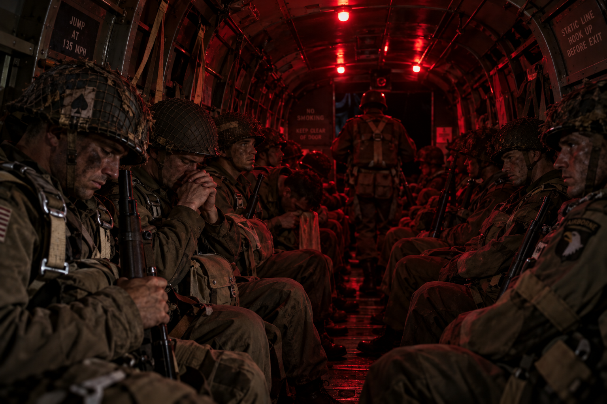

The jumpmaster moves down the line shouting over the engines and giving final checks. “Stand up! Hook up!” his voice sharp, practiced, and urgent.

Suddenly, the plane shudders violently. A burst of flak explodes nearby rocking the aircraft hard enough to throw men off balance. The engine whines, uneven now. Another explosion, this one closer. The red light flickers. Someone curses. Through the small side windows black puffs of anti-aircraft fire bloom all around uncomfortably close. The pilot doesn’t wait. The red light snaps off...

**Green.**

_“GO! GO! GO!”_

The jumpmaster slams the side of the fuselage and the line surges forward. One by one, men disappear into the night.

The moment you step out, the world vanishes into wind and darkness. The roar of the engines is replaced by a deafening rush of air as you tumble into open sky. For a split second there is no up or down, just chaos and falling.

Then your chute snaps open with a violent jerk, wrenching you upright.

The battlefield stretches below with patchwork fields, hedgerows, and distant fires burning where bombs have already struck. Tracer rounds streak upward in thin lines of light, and flak bursts bloom like dark flowers in the sky.

Above you, the plane you just left takes another hit.

There’s a flash and then fire pours from one wing. The aircraft lurches, banking hard. For a moment it seems to fight it with engines straining. Then it rolls slow and terrible onto its back. A final burst of flame erupts from the fuselage as it breaks apart midair.

The burning wreck spirals downward, trailing smoke and debris before disappearing into the darkness below.

Around you, other parachutes dot the sky with some drifting wide, others descending too fast, and a few tangled or trailing. The wind pulls at you dragging you off course. The ground is coming up faster now.

You are alone in the night, descending into enemy territory.

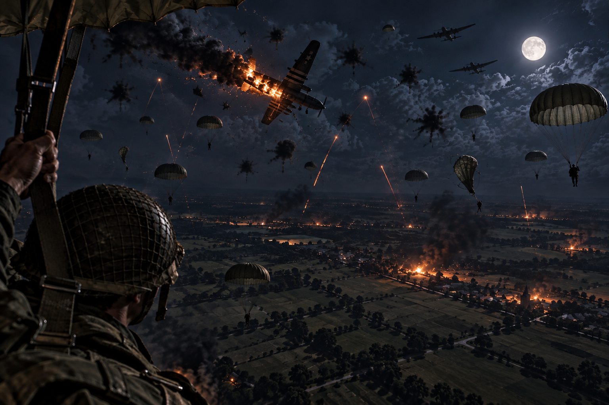

##### Landing Site

You descend into a dark, unfamiliar countryside. Your landing zone is a patchwork of small Norman fields divided by thick hedgerows, drainage ditches, narrow country roads, scattered trees, and isolated farms. In the darkness, you land far from the intended drop point. 

Landing Zone D.

###### Mishap Check

Characters need to roll a RES/Athletics Saving throw of difficult (3 successes) to avoid mishap on landing. 
	3 saves - Avoid Injury or equipment loss
	2 saves - Minor Wound
	1 save - Minor Wound, roll on the equipment table 
	0 saves - Serious Wound, roll on the Equipment Lose Table +3  

###### Equipment Lost Table

| \#  | Results                                                                                                                             |
| --- | ----------------------------------------------------------------------------------------------------------------------------------- |
| 1   | Personal/Field Gear - Clothing, socks, entrenching tool, miscellaneous equipment that could not conveniently be carried on the body |
| 2   | K-rations, D-ration chocolate, emergency food                                                                                       |
| 3   | Water Canteens or additional water                                                                                                  |
| 4   | Fragmentation grenades, smoke grenades, TNT blocks, Composition C, demolition charges                                               |
| 5   | Extra M1 rifle clips, carbine magazines, Thompson magazines, BAR magazines                                                          |
| 6+  | Roll again, and also on Advanced Loss Table\*                                                                                       |

*\* Only once*

###### Advanced Lost Table

| \#  | Results                                                                                                                      |
| --- | ---------------------------------------------------------------------------------------------------------------------------- |
| 1   | Primary Weapon Damaged - Weapon is damaged during the jump or landing and requires attention before it can be used reliably. |
| 2   | Flooded Field - Lands in deliberately flooded lowlands and must escape waist high water while carrying heavy equipment.      |
| 3   | Tree Landing - Parachute becomes caught in a tree, leaving the paratrooper suspended above the ground.                       |
| 4   | River/Canal Landing - Lands in a waterway and must quickly shed equipment to avoid drowning.                                 |
| 5   | Primary Weapon Lost - Land in a hedgerow, and primary weapon is lost and cannot be found.                                    |
| 6   | German Patrol Nearby - Lands close enough to enemy troops that immediate concealment or combat may be necessary.             |

##### **Where to now?**

Once on the ground, you must quickly free yourselves from your parachute, recover your weapon and equipment, determine your location, and find other members of your unit. With the target still miles away, you face a long march through enemy-held countryside, avoiding German patrols and strongpoints while following back roads, fields, and hedgerows toward the river and causeway they have been ordered to secure.

Since your plane was shot down early, you didn't reach the expected drop zone. you don't know where you are.  

You do have a compass and know which direction to travel. You have a map of the overall area and know where the ultimate target is located.
, or a combination of several other less defined landmarks (streams, trails, roads, railways, hills, etc.).

The characters need to progress through 3 Sections (A, B, C) before reaching the causeway.

Each time the characters resolves an Event/Landmark in a Section it increases their chance of identifying their location. After encountering an Event/Landmark, let the players select a character to roll a Section INT + Investigation or ACT + Survival check starting at 5 successes. One other character may offer to help (+1 die). The difficulty decreases by one level for each successive Event/Landmark investigated in that Section. On success, move to the next Section.

Encounters (choose from list of Events/Landmarks):
- Start with an Events/Landmarks from Section A.
- Then an Events/Landmarks from Section B.
- Finally Events/Landmarks from Section C until the characters determine their location.
- Additional Events/Landmarks of any section can be selected if the GM thinks the characters have not been challenged enough.

Once the characters identify their location, they can head to the causeway objective.

##### Tracking Time

It is 1:30 a.m.

The attack on the causeway is planned for 6:00 a.m. You need to be there on time.

Each Event/Landmark takes at least 30 minutes. Some choices made resolving the Event/Landmark may increase the time spent. Characters may also take longer if they choose to linger or rest.

##### **Events/Landmarks - Section A**

###### Random Table A

| \#  | Results                                     |
| --- | ------------------------------------------- |
| 1   | Dead American Paratrooper Hanging in a Tree |
| 2   | Empty Farmhouse                             |
| 3   | Stream                                      |
| 4   | Traumatized American Paratrooper            |
| 5   | Night Drop Scattered Supplies Cache         |
| 6   | Railroad Tracks.                            |

###### **1) Dead American Paratrooper Hanging in a Tree**

Situation: Dead paratrooper hanging from a tree.

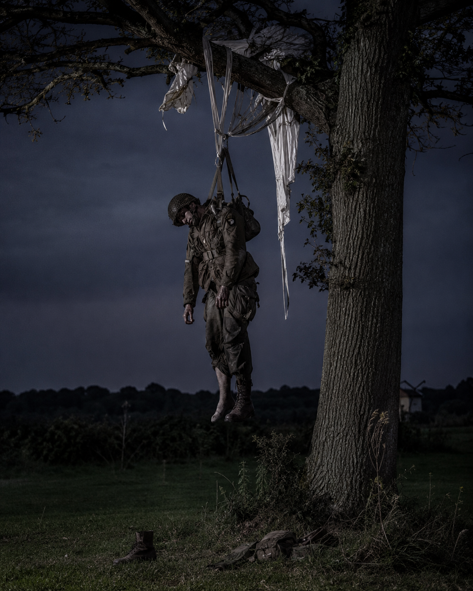

A paratrooper hangs motionless from a tall tree at the edge of a Norman field. His parachute caught in the upper branches during the chaotic night drop, leaving him suspended 12 feet above the ground. His helmet hangs crooked from its chinstrap, and one boot is missing, lying in the grass beneath him alongside part of his scattered equipment. 

Pfc. Thomas “Tom” Mercer, a 21-year-old rifleman from Columbus, Ohio, was a member of the characters' platoon and someone they all knew well. Tom was thin and youthful, with short sandy-brown hair, a narrow face, and the beginnings of a beard. Tom was the platoon's jokester, always ready with a wisecrack when training became miserable or an officer was safely out of earshot. During training back in the States, he once slipped a brick into a buddy's field pack before a long march and spent the first several miles loudly praising him for finally "getting into fighting shape." When the exhausted soldier discovered the brick at the next rest stop, he found "PROPERTY OF THE U.S. ARMY—DO NOT LOSE" written across it in chalk. Tom spent the rest of the march carrying the brick himself as punishment, still joking about it. The characters remember sharing cigarettes with him after training, playing cards in the barracks, listening to him complain about Army food, and enduring his endless practical jokes. Seeing the normally energetic young soldier hanging silently from a Normandy tree makes his death particularly unsettling.

He still carries his M1 Garand, ammunition belt with several loaded clips, two fragmentation grenades, first-aid packet, canteen, trench knife, entrenching tool, compass, K-rations, and a small waterproof packet containing a map and recognition instructions. In his pockets are a Zippo lighter, a half-empty pack of Lucky Strikes, $11 in American currency, a rosary, and a folded photograph of his parents and younger sister with _“Come home safe, Tommy”_ written on the back. His leg bag is nowhere to be seen, apparently torn away during the jump.

Opportunities:
- Recover ammo, weapon, maps, or other equipment
- Identify unit markings or orders

Complications:
- Body visible from distance (risk of discovery)
- Enemy patrol may investigate
- Emotional/morale impact

Potential Checks:
- STR + Athletics to retrieve gear safely
- ACT + Perception to spot approaching patrol
- RES + ACT saving throw (morale) to avoid stress penalty (Distracted for 30 minutes)

Outcomes:
- Success: Gain useful equipment or intel
- Failure: Delay or exposure leads to encounter

###### **2) Empty Farmhouse**

Situation: Recently abandoned; signs of hurried departure.

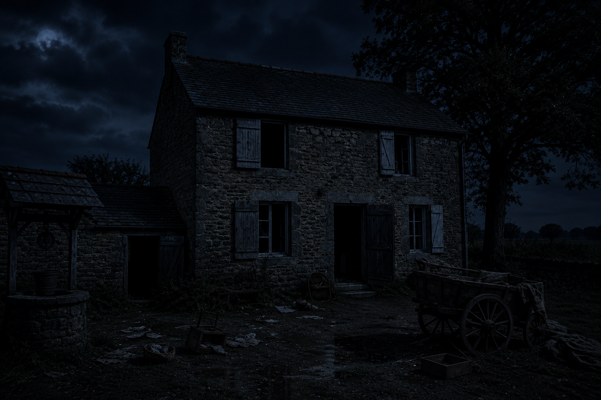

The small stone farmhouse stands silent beside a narrow country lane, its front door hanging partly open and one shutter banging softly in the wind. The family who lived here appears to have left in a great hurry. An unfinished meal remains on the kitchen table, chairs have been pushed aside, drawers and cupboards stand open, and clothing is scattered across an upstairs bedroom. A child's wooden toy lies abandoned near the doorway, while several framed family photographs remain on a shelf. Most valuables and portable food are gone, but the characters can find a little bread and cheese, several bottles of cider, blankets, basic tools, matches, candles, and a small first-aid box. Outside, the barn is empty except for loose hay and farming implements, and wagon tracks lead away toward the road. There are no bodies and no obvious signs of fighting. The occupants apparently heard or saw the approaching invasion and fled before the paratroopers arrived. The farmhouse provides temporary shelter and concealment, but its open doors and hurriedly abandoned rooms leave an uneasy question: what frightened the family enough to make them leave everything behind?

(Optional) Hidden French Resistance fighter named René Gautier. He knows only a little English. If characters locate him and persuade him to help, he will assist by adding +1 to the next location check.

Opportunities:
- Scavenge supplies (rations, wine, blankets)
- Use as temporary hideout or observation point

Complications:
- Hidden wounded civilian or resistance fighter
- Booby trap or mine left behind
- German patrol using it intermittently

Checks:
- ACT + Investigation to spot traps or hidden items
- ACT + Survival to find useful supplies
- DEX + Stealth if remaining inside

Outcomes:
- Success: Gain supplies or safe rest (recover fatigue/wounds)
- Failure: Trigger trap or alert nearby enemies

###### **3) Stream**

Situation: Natural obstacle with concealment advantages.

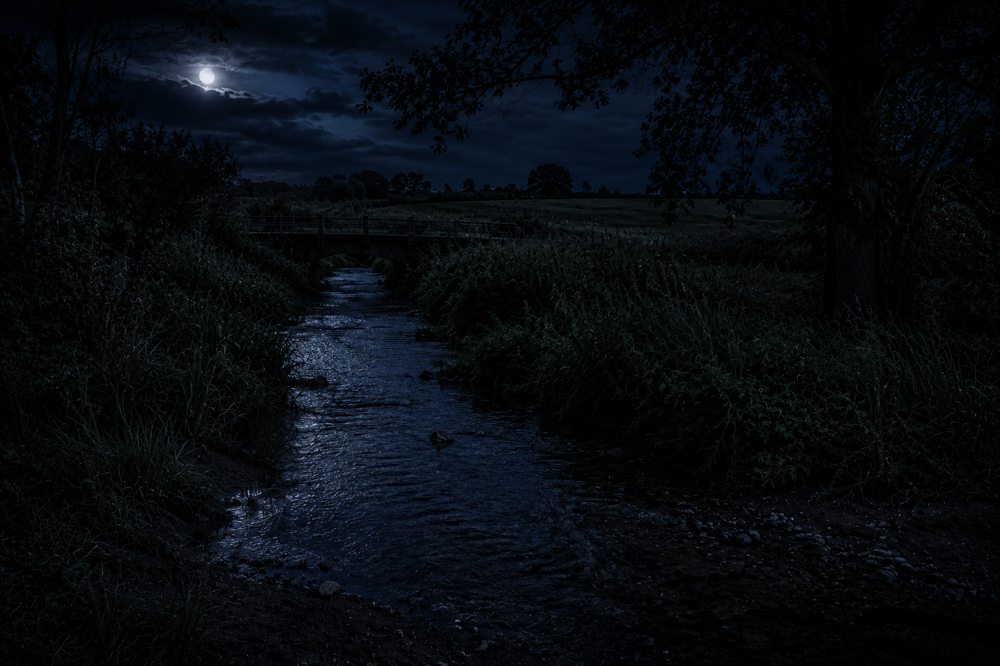

A narrow stream cuts through the Norman countryside, winding between hedgerows and low fields beneath a thick screen of reeds, brush, and overhanging trees. The water is cold and shallow enough to wade in most places, but the muddy banks are steep and slippery, making a hurried crossing difficult. Especially for paratroopers burdened with weapons and equipment. 

The stream can also be an advantage: 
1) by following its course, the characters can use the sunken banks and heavy vegetation to move unseen through the countryside, 
2) or conceal themselves along the bank to ambush a passing German patrol. 
 
Crossing quickly is possible but risks splashing, slipping, or making enough noise to reveal their position. Spending too long in the cold water may cause fatigue, and obvious fords, bridges, and shallow crossing points are dangerous places to linger, as German patrols may already be watching them.

Options:
- Cross quickly
- Follow for stealth movement
- Use for ambush

Complications:
- Slippery banks, noise risk
- Cold water (fatigue)
- Enemy watching crossing points

Checks:
- STR + Athletics to cross safely
- DEX + Stealth when moving along stream
- ACT + Perception to scout for threats

Outcomes:
- Success: Reduced detection chance next encounter
- Failure: Noise or delay draws enemy attention

###### **4) Traumatized American Paratrooper**

Situation: Shell-shocked soldier, disoriented and frightened.

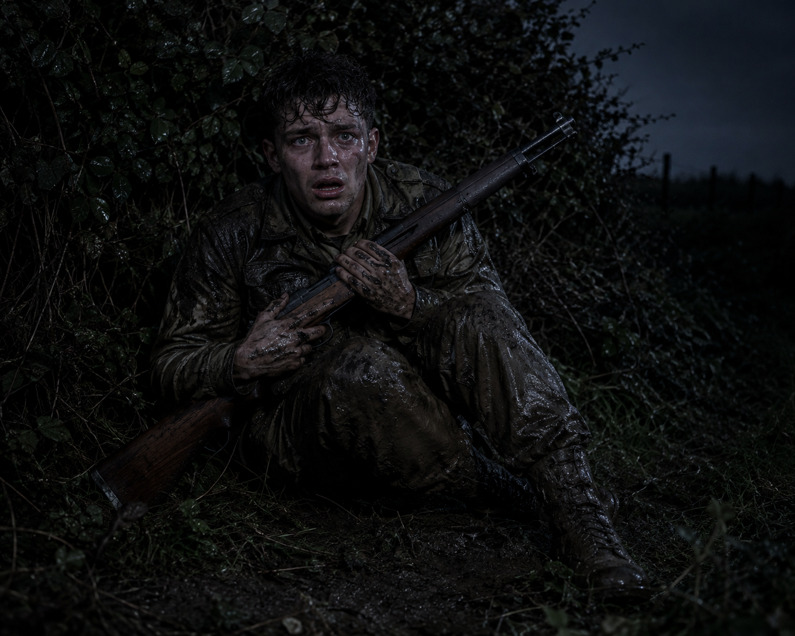

The characters find Pfc. Raymond “Ray” Keller, a 19-year-old rifleman from Pittsburgh serving with the 501th Parachute Infantry Regiment, crouched beneath a hedgerow with his M1 Garand held tightly across his chest. His helmet and much of his equipment are gone, his uniform is soaked with mud, and his hands shake uncontrollably. 

Keller's transport came under intense antiaircraft fire during the drop, and since landing he has seen several paratroopers killed while trying to find his unit. He is exhausted, frightened, and badly disoriented, but can provide useful information about where other paratroopers landed, German patrol movements, and the direction from which he heard heavy weapons fire. 

No amount of encouragement or orders, however, will convince Keller to accompany the characters. He insists that he is staying where he is until daylight or until men from his own unit find him. If pressured, he becomes increasingly agitated and may shout, cry out, or raise his weapon defensively, potentially attracting enemy attention. The characters must decide whether to leave him concealed in the hedgerow, spend valuable time trying to calm him, or somehow get word of his location to other members of the 501st.

Opportunities:
- Gain intel about drop zones or enemy positions

Complications:
- Loud outbursts risk detection
- May refuse to move or follow orders
- Could panic under fire

Checks:
- PRS + Influence to calm
- PRS + Medicine (Psychological) to stabilize
- ACT + Stealth to avoid detection

Outcomes:
- Success: Gains clarity, provides intel or assists (+1 die on Section check)
- Failure: Creates noise or delays squad

###### **5) Night Drop Scattered Supplies Cache**

Situation: A supply bundle from the drop hangs tangled in a hedgerow or lies half-buried in a field.

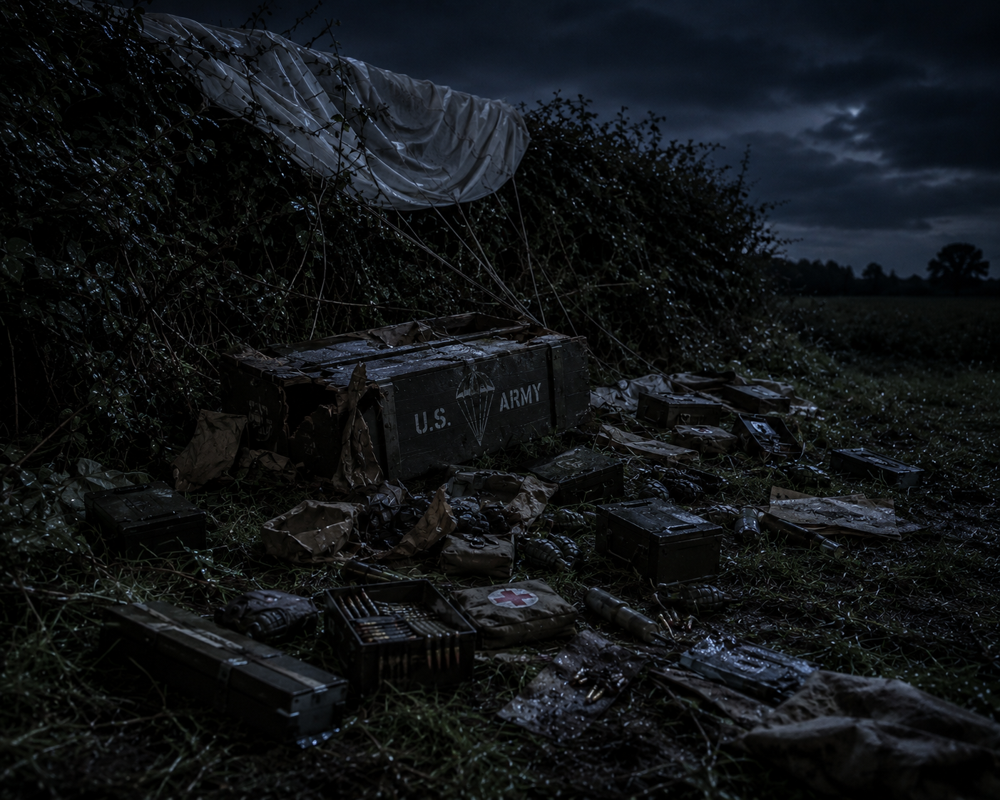

A pale parachute canopy snagged across the top of a hedgerow marks the location of an American supply bundle dropped during the night. The heavy container struck the field hard, splitting part of its casing and scattering equipment through the wet grass and brush. Inside, the characters can recover M1 rifle ammunition, grenades, medical dressings, rations, demolition explosives, detonators, spare radio batteries, and waterproof map packets. Some items have been ruined by the impact or soaked with water, and searching through the scattered contents takes valuable time. 

Worse, the white parachute is clearly visible against the dark countryside, and footprints near the bundle suggest the characters may not be the first to discover it. A nearby German patrol has also spotted the parachute and is moving toward the cache. This forces the characters to decide whether to grab what they can and leave, conceal themselves and wait, or use the abandoned supplies as bait for an ambush.

Opportunities:
- Recover ammo, medical supplies, explosives
- Find mission-critical gear (radio batteries, maps)

Complications:
- Nearby German patrol searching for the same cache
- Parachute canopy visible from afar
- Some supplies damaged on impact

Checks:
- ACT + Perception to locate intact supplies
- DEX + Stealth to recover unnoticed
- INT + Survival to salvage usable gear

Outcomes:
- Success: Gain bonus equipment or restore resources
- Failure: Enemy discovers location or ambushes

###### **6) Railroad Track**

Situation: Key logistical route through open terrain.

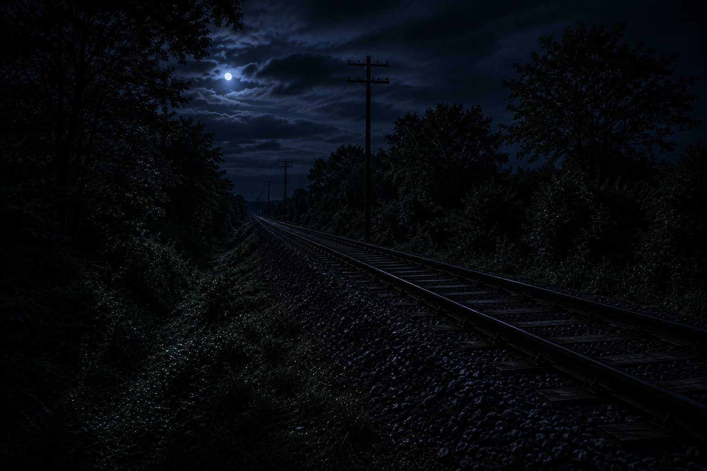

A raised railroad line cuts across the countryside ahead, running straight through otherwise open farmland and providing the Germans with an important route for moving troops and supplies through the region. The gravel embankment and steel rails offer little concealment, forcing anyone crossing them to spend several dangerous moments exposed against the skyline. The characters can:

1) cross quickly and continue toward their objective, 
2) remain concealed along a hedgerow to observe the tracks for German troop or train movements, 
3) or attempt to sabotage the railway by damaging the rails, switches, or track bed with demolition charges. 

Sabotage could disrupt German reinforcements later, but preparing explosives takes valuable time and risks revealing the squad's presence. German patrols periodically inspect the railway, and the distant vibration or whistle of an approaching train may suddenly force the characters to abandon their plans or seek cover.

Options:
- Cross quickly
- Sabotage tracks
- Observe for troop movement

Complications:
- Patrols or trains nearby
- Open ground = high exposure
- Sabotage takes time

Checks:
- DEX + Stealth to cross unseen
- INT + Technology if sabotaging
- ACT + Perception for timing movement

Outcomes:
- Success: Disrupt enemy logistics or cross safely
- Failure: Detected. Enemy response increases

##### **Events/Landmarks - Section B**

###### Random Table B

| \#  | Results                                           |
| --- | ------------------------------------------------- |
| 1   | Three Dead German Soldiers                        |
| 2   | Guard Post                                        |
| 3   | Destroyed American Glider with Dead Troops Inside |
| 4   | German Motorcycle Patrol                          |
| 5   | Wounded German Soldier                            |
| 6   | Enemy Flare Illumination                          |

###### **1) Three Dead German Soldiers**

Situation: Recently killed; battlefield still quiet.

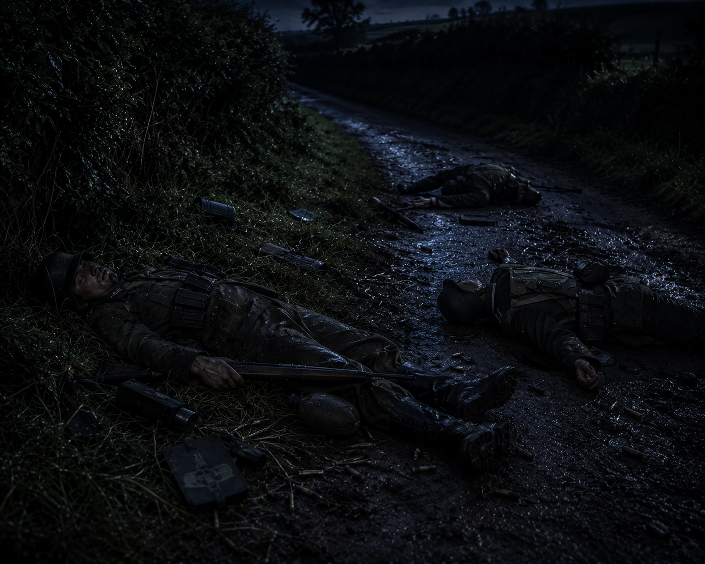

Three German soldiers lie dead beside a sunken country lane, their bodies partly concealed by the grass and shadow of a nearby hedgerow. The fighting appears to have happened only recently: spent cartridge cases litter the road, one soldier still grips his Kar98k, and another lies several yards away as though he tried to reach cover. Their weapons, ammunition, field gear, rations, and canteens remain largely untouched, while an officer or NCO's map case may contain orders, identification papers, a local map, or notes concerning nearby German positions and patrol routes. 

Examining the scene could reveal what happened. The direction of the gunfire, American boot prints disappearing through the hedge, or signs that other paratroopers passed through shortly before the characters arrived. The silence, however, is troubling. Whoever killed these men may still be nearby, and the characters cannot know whether they are friendly troops or another threat. The bodies themselves should be approached cautiously in case explosives have been left beneath them, while distant voices or an approaching vehicle could signal a German patrol coming to discover why its soldiers have failed to report.

Opportunities:
- Loot weapons, ammo, documents
- Determine what happened

Complications:
- Ambush nearby (who killed them?)
- Booby-trapped bodies
- Patrol coming to investigate

Checks:
- ACT + Perception to assess scene
- INT + Survival or Investigation to reconstruct events
- DEX + Stealth to avoid follow-up patrol

Outcomes:
- Success: Gain intel (Friendly movement clue. +1 die for location check)
- Failure: Walk into ambush or trigger trap

###### **2) Guard Post**

Situation: Fortified position controlling movement.

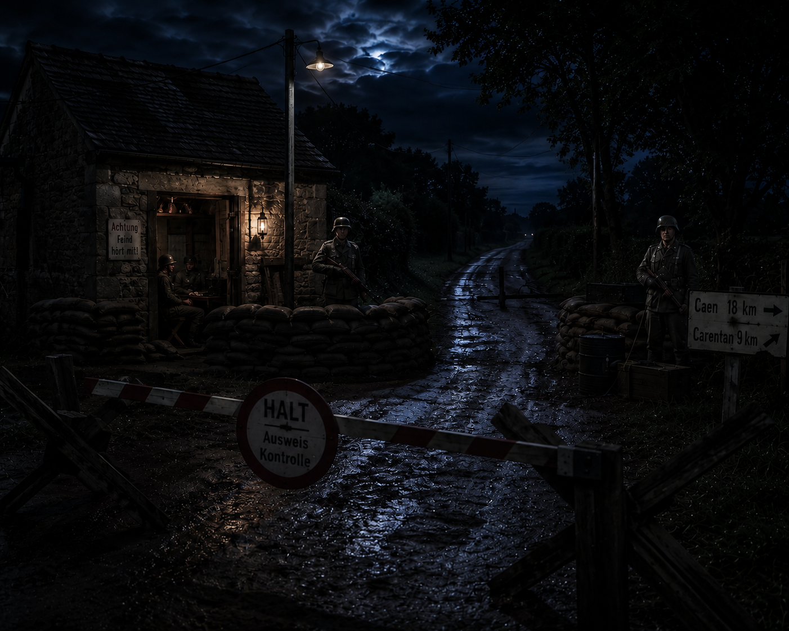

A German guard post controls a narrow road junction the paratroopers need to pass on their way toward the causeway. The position has been established around a small stone farm outbuilding beside the road, reinforced with sandbags and a shallow fighting position. A wooden barrier blocks most of the roadway, forcing vehicles and civilians to stop for inspection. Four German soldiers man the post. Two soldiers normally watch the road while the other two rest inside the building. A field telephone or radio connects the post with a nearby German unit, and a sentry has immediate access to an alarm whistle or flare pistol.

The characters can avoid the position entirely by leaving the road and working through the surrounding fields and hedgerows, although doing so costs valuable time. A carefully planned silent approach might allow them to eliminate or capture the exposed sentries before the alarm is raised, but the location of every defender may not be immediately apparent. Characters with suitable German uniforms, documents, or a prisoner might instead attempt a bluff, particularly in the confusion following the airborne landings. The guards know American paratroopers are somewhere in the area, however, and may become suspicious of unfamiliar soldiers or incorrect answers.

Once alerted, one man immediately attempts to telephone or radio for assistance, potentially bringing a Kübelwagen patrol, truckload of infantry, or other nearby troops within minutes. Destroying the communications equipment, preventing an alarm, or simply slipping around the position may therefore be more important than defeating every German soldier present.

What the characters can learn: Observation before acting can reveal the sentry rotation, communication wires leading away from the building, and periods when only two or three Germans are visible. Capturing the post may also provide German maps, patrol schedules, ammunition, food, field telephone equipment, and information about other checkpoints between the paratroopers and their objective.

Options:
- Silent takedown
- Disguise/bluff
- Avoid entirely

Complications:
- Alarm system or radio
- Reinforcements nearby

Checks:
- DEX + Stealth for infiltration
- PRS + Influence (deception) for bluff
- Combat if assaulting

Outcomes:
- Success: Clear path, possible intel gain
- Failure: Alarm raised. Alert Level rises. Future encounters harder

###### **3) Destroyed American Glider with Dead Troops Inside**

Situation: Wreckage of a failed landing with equipment scattered among the dead.

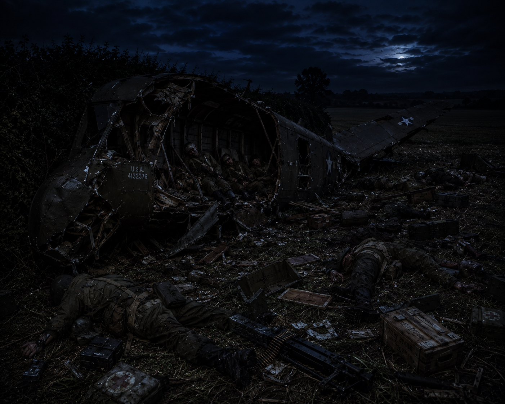

The shattered remains of an American Waco CG-4A glider lie at the far end of a field, its nose crushed against a hedgerow and one wing torn away during the violent landing. Several American airborne soldiers are dead inside the broken fuselage, still strapped into their seats or thrown among splintered wood, equipment, and cargo. Others lie outside where they were pulled or thrown from the wreckage. The crash has scattered ammunition, medical supplies, demolition gear, and heavier weapons across the field, some damaged but much still usable. A map case or officer's equipment may contain useful maps, orders, or information about nearby objectives. Searching the wreck could provide the squad with equipment normally unavailable to lightly armed paratroopers, but the large glider is easily visible from surrounding roads and fields. Tracks and disturbed equipment suggest German soldiers may already have discovered the wreck and could return to continue scavenging it. For the characters, searching the bodies and wreckage also carries an emotional cost: these men crossed the Channel as part of the same invasion, only to die before they ever had a chance to fight.

Opportunities:
- Recover heavy weapons, ammo, radios
- Find mission documents or maps

Complications:
- Crash site visible from afar
- Enemy scavenging party nearby
- Emotional toll on squad

Checks:
- ACT + Perception to scout area
- INT + Survival to recover intact gear
- RES + ACT saving throw to avoid morale penalties (Distracted 30 minutes)

Outcomes:
- Success: Gain powerful gear or mission intel
- Failure: Enemy contact or time lost

###### 4) German Motorcycle Patrol

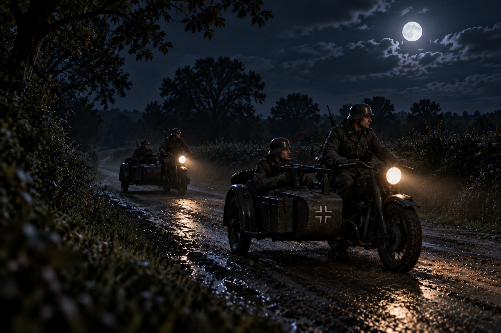

Two German motorcycles with sidecars patrol a narrow country road, each carrying a driver and armed passenger. The four soldiers travel at moderate speed, slowing at intersections, farmhouses, and suspicious movement. The sound of their engines gives the paratroopers warning before they appear.

Options:
- Hide and let them pass
- Ambush
- Bluff: Attempt to pass as civilians or friendly personnel if circumstances allow.

Complications:
- One motorcycle may race away to raise the alarm if fighting begins. 
- Gunfire could attract nearby German troops. 
- A motorcycle or sidecar damaged during the encounter might be captured and used for transportation.

Checks:
- DEX + Stealth to remain hidden
- ACT + Perception to spot the motorcycles early enough to react before they arrive
- DEX + Ranged Combat to disable a motorcycle, driver, or passenger before they can escape.

Outcome:
- Success: Avoid or eliminate threat
- Failure: Engagement on enemy terms

###### **5) Wounded German Soldier**

Situation: A wounded enemy soldier lies hidden, bleeding but conscious.

The characters hear a faint groan from beneath the tangled branches of a hedgerow and discover a wounded German soldier lying in a shallow ditch. He is pale and frightened, with a blood-soaked field dressing wrapped around his thigh and his Kar98k lying just beyond his reach. He is conscious and understands only limited English, but with gestures, basic German, or an interpreter, the characters may question him about nearby units, patrol routes, checkpoints, or German positions. Whether frightened, loyal, or simply desperate to survive, he may provide useful information—but he might also lie, exaggerate German strength, or deliberately stall the Americans in hopes that help arrives. The characters can treat his wound and leave him behind, attempt to take him prisoner, or otherwise prevent him from revealing their presence. Leaving him unattended carries its own risk: once the Americans disappear, he may shout for help or warn approaching troops. Fresh tracks along the nearby lane suggest an additional danger—a German patrol may already be searching for their missing comrade.

Options:
- Interrogate
- Leave him
- Treat or silence him

Complications:
- He may lie or stall
- Could cry out if left unattended
- Nearby patrol searching for him

Checks:
- PRS + Influence (persuasion or intimidation)
- INT + Medicine if stabilizing
- DEX + Stealth if withdrawing quietly

Outcomes:
- Success: Gain intel
- Failure: Noise or deception causes trouble. Raise Alert Level

###### **6) Enemy Flare Illumination**

Situation: A flare suddenly lights the sky, turning night into day.

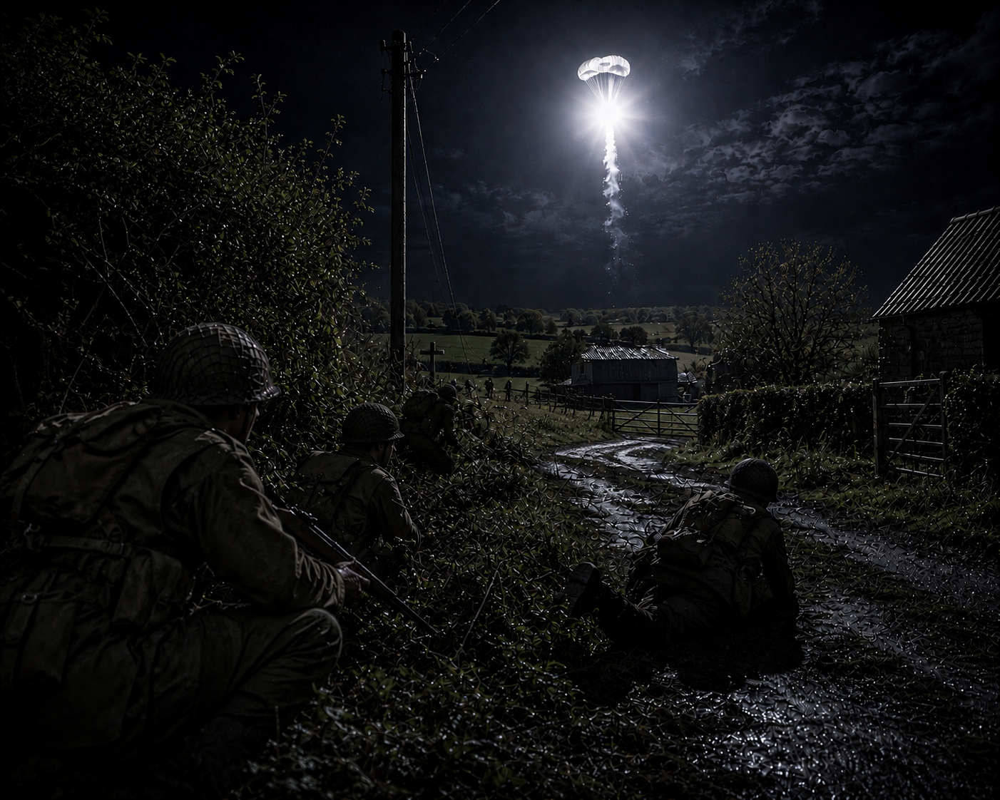

Without warning, a sharp pop sounds somewhere in the darkness and a brilliant white flare climbs overhead. Seconds later, the surrounding fields, hedgerows, roads, and farm buildings are washed in an eerie, shifting light as the flare drifts slowly beneath its parachute. Shadows become stark and movement suddenly becomes dangerously easy to spot. The characters have only moments to react: 

1) they can freeze in place, hoping their uniforms and the surrounding vegetation keep them unnoticed, 
2) dive for the nearest ditch, hedgerow, wall, or other cover, risking a brief burst of visible movement, 
3) or run for better concealment, gambling that they can reach it before German observers notice them. 

Anyone caught in open ground is especially vulnerable. The flare burns for less than a minute before fading, but during that brief interval German sentries may scan the illuminated countryside, machine-gun crews may turn toward suspicious movement, and another flare could already be on its way.

Immediate Reaction Encounter

Options:
- Freeze in place
- Dive for cover
- Run (risky)

Checks:
- DEX + Stealth to remain unnoticed
- STR + Athletics to reach cover
- PRS + Command to coordinate reaction

Outcomes:
- Success: Avoid detection
- Failure: Enemy spots movement and starts engagement

##### **Events/Landmarks - Section C**

###### Random Table C

| \#  | Results                             |
| --- | ----------------------------------- |
| 1   | Farmhouse with French Family        |
| 2   | Farmhouse with German Troops        |
| 3   | Hedgerow Ambush Site                |
| 4   | Burning Village Edge                |
| 5   | Church Bell Tower Observation Point |
| 6   | Roadblock with Civilian Cart        |

###### **1) Farmhouse with French Family**

Situation: A farmhouse with a frightened French family sheltering inside. 

A faint light shows through the shuttered windows of a small stone farmhouse, where the characters discover a French family sheltering inside. 

Dumont family: Henri Dumont, a 58-year-old farmer; his wife Madeleine, 55; their daughter Élise, 27; and Élise's two children, Jean, 9, and Sophie, 6.

The family initially reacts to the armed strangers with terror, but the sight of American uniforms brings cautious relief. None speaks more than a few words of English, so communication must rely on gestures, maps, place names, and whatever French the paratroopers can manage. Henri and Élise have seen German patrols using the nearby roads and scattered American paratroopers moving through the fields, and can identify a German guard post, frequently traveled roads, and concealed paths through the hedgerows. Madeleine offers bread, cheese, apples, cider, and fresh water, while Henri reluctantly allows the soldiers to shelter in the barn or farmhouse. Their willingness to help is tempered by fear. The Dumont's know that German reprisals could fall upon the entire family if the Americans are discovered. Worse, a neighbor may have noticed unusual activity at the farm, and the sound of an approaching vehicle could signal a German patrol arriving while the paratroopers are still inside.

Opportunities:
- Gain intel (enemy patrol routes, nearby guard post, safe paths)
- Acquire food, water, or civilian clothing
- Hide temporarily

Complications:
- Family fears reprisals if discovered helping
- A neighbor may report suspicious activity
- German patrol could arrive mid-conversation

Checks:
- Presence + Influence to earn trust
- Investigation to detect withheld information
- Stealth if hiding from patrol

Outcomes:
- Success: Gain intel advantage (reduced difficulty on next navigation/stealth scene)
- Failure: Family panics or refuses aid; possible noise draws attention

###### **2) Farmhouse with German Troops**

Situation: Occupied by a small German unit resting or staging patrols.

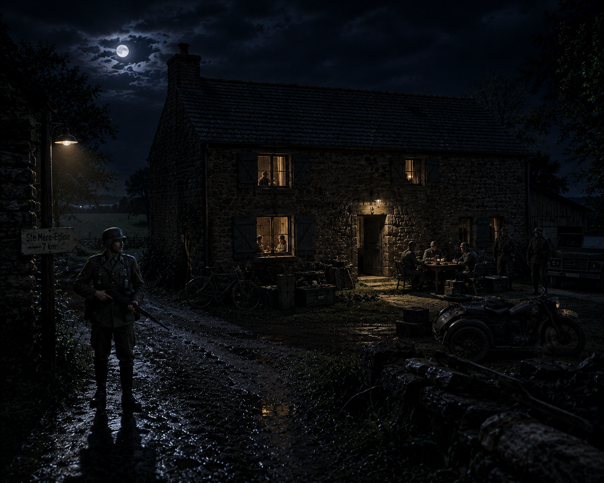

A bicycle and several pieces of German field equipment outside an isolated stone farmhouse are the first signs that it has been occupied by a small German unit. Through the shuttered windows, the characters can glimpse soldiers eating, resting, and preparing equipment while a sentry occasionally watches the road from the farmyard. The farmhouse appears to serve as a temporary patrol post, but it is difficult to determine how many Germans are actually inside; additional troops may be sleeping upstairs or sheltering in the barn. The characters can infiltrate the farm quietly, establish an ambush for the next patrol leaving the building, or avoid the position entirely and continue toward their objective. A radio antenna running from an upstairs window suggests the Germans have communications equipment and could quickly call for reinforcements if fighting begins. Complicating matters further, the French farmer who owns the property is being held inside with his wife, Pierre and Marguerite Dubois, preventing the Americans from simply attacking the farmhouse without risking civilian lives.

Options:
- Stealth infiltration
- Ambush
- Avoid entirely

Complications:
- More troops inside than visible
- Radio equipment for reinforcements
- Civilian hostage inside

Checks:
- DEX + Stealth for approach/infiltration
- Ranged or Close combat if engaging
- PRS + Survival to coordinate ambush

Outcomes:
- Success: Eliminate unit, gain intel or gear
- Partial: Noise triggers reinforcements later
- Failure: Squad takes wounds, mission pressure increases

###### **3) Hedgerow Ambush Site**

Situation: Dense hedgerows create tight, claustrophobic lanes—perfect for ambush.

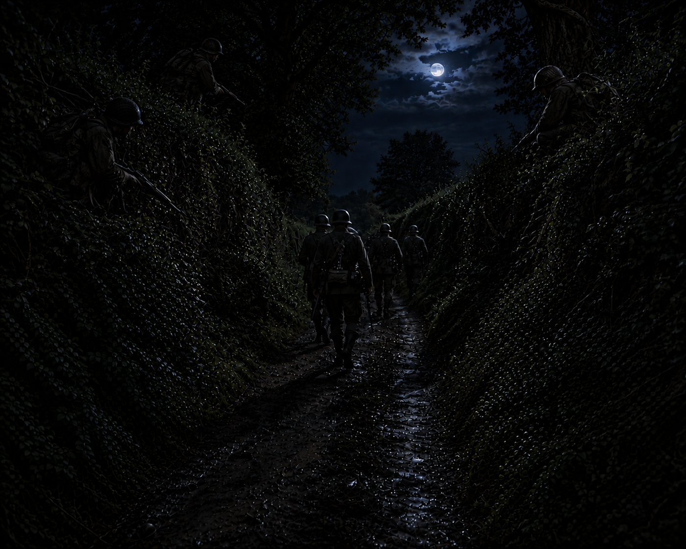

The narrow country lane disappears between towering Norman hedgerows, their tangled walls of earth, roots, thorny brush, and dense vegetation rising several feet above the road. Visibility is limited to only a short distance, and every bend or opening could conceal enemy troops. The position offers the characters an excellent opportunity to set an ambush, allowing a German patrol to enter the confined lane before attacking from concealed positions along the banks. Alternatively, they can move cautiously through the area or bypass it through the surrounding fields, sacrificing time to reduce the risk of contact. The same terrain that makes the location ideal for an American ambush makes it equally dangerous. The Germans may already be waiting among the hedgerows. If fighting begins, it will likely occur at close range, with poor visibility and soldiers firing from several directions, creating a serious risk of confusion and friendly fire among scattered American units operating nearby.

Options:
- Set ambush on a patrol
- Carefully move through
- Bypass entirely

Complications:
- Limited visibility (close-range combat)
- Enemy may already be waiting
- Friendly fire risk

Checks:
- DEX + Stealth to position
- ACT + Perception to detect enemy first
- INT + Survival to coordinate ambush

Outcomes:
- Success: Surprise attack advantage
- Failure: Squad is ambushed instead

###### **4) Burning Village Edge**

Situation: A nearby village burns, smoke rising into the night. Occasional gunfire echoes.

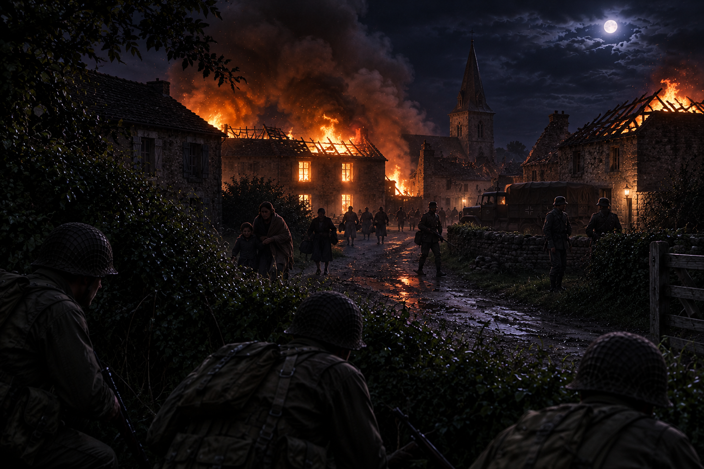

An orange glow flickers beyond the hedgerows as the characters approach the outskirts of a small Norman village partially engulfed in flames. Several houses and a barn are burning fiercely, sending thick columns of smoke into the night while frightened civilians flee between buildings carrying children, blankets, and whatever possessions they managed to save. Sporadic rifle and machine-gun fire echoes from deeper within the village, but in the darkness it is impossible to tell who is fighting whom. The smoke, confusion, and shifting firelight provide excellent concealment for moving past German positions, while survivors may know about nearby patrols, checkpoints, or safer routes toward the characters' objective. The characters might also discover wounded civilians or a local Resistance contact trapped amid the fighting. Entering the village carries considerable risk: 

1) German troops are moving from building to building searching for enemies, 
2) panicked civilians may inadvertently reveal the Americans' presence, 
3) wind-driven flames could suddenly block streets or spread to buildings the characters are using for cover.

Opportunities:
- Use chaos for cover
- Rescue civilians or resistance contact
- Gather intel from survivors

Complications:
- German troops clearing the area
- Fire spreading unpredictably
- Civilians panicking

Checks:
- DEX + Stealth to move through smoke
- PRS + Influence to calm civilians
- RES + ACT saving throw vs. smoke/fire stress

Outcomes:
- Success: Gain ally or intel
- Failure: Exposure or injury from fire/enemy

###### **5) Church Bell Tower Observation Point**

Situation: A small church with a bell tower overlooking the countryside.

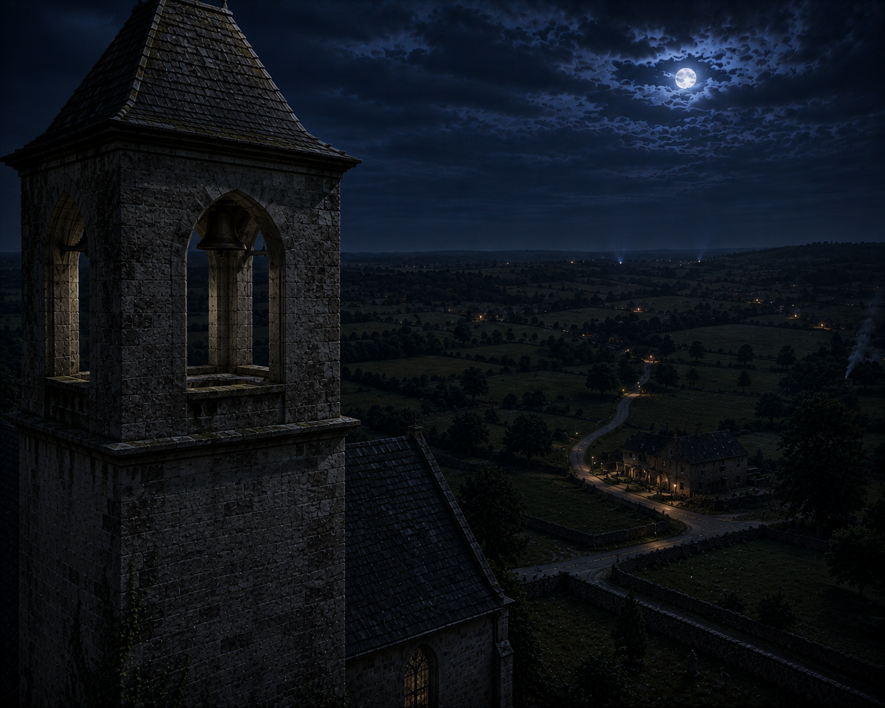

A small stone church rises above the surrounding farms and hedgerows, its square bell tower offering a commanding view of the countryside. From the top, the characters could orient themselves using roads, villages, waterways, and other landmarks, while also observing German patrol routes, checkpoints, vehicle movements, or the direction of their objective. 

Reaching the tower requires passing through the darkened church and climbing a narrow wooden staircase to the bell chamber. The position may not be abandoned, however, a German sniper, artillery observer, or sentry could already be using the tower for exactly the same reason. Moving carelessly among the ropes and timbers could accidentally sound the church bell, announcing the characters' presence across the countryside. Even if they reach the top undetected, anyone silhouetted in the windows risks being spotted from below. Once the Germans realize the tower is occupied, its exposed position could quickly become a target for rifle, machine-gun, or mortar fire.

Opportunities:
- Gain high-ground observation
- Spot patrol routes or objective location

Complications:
- Sniper or observer already inside
- Bell could accidentally ring
- Tower is exposed if spotted

Checks:
- DEX + Stealth to climb unnoticed
- INT + Perception for intel gathering
- Ranged Combat if engaging enemy

Outcomes:
- Success: Major intel advantage (map reveal)
- Failure: Exposed position → incoming fire

###### **6) Roadblock with Civilian Cart**

Situation: A German checkpoint halts a civilian cart loaded with goods.

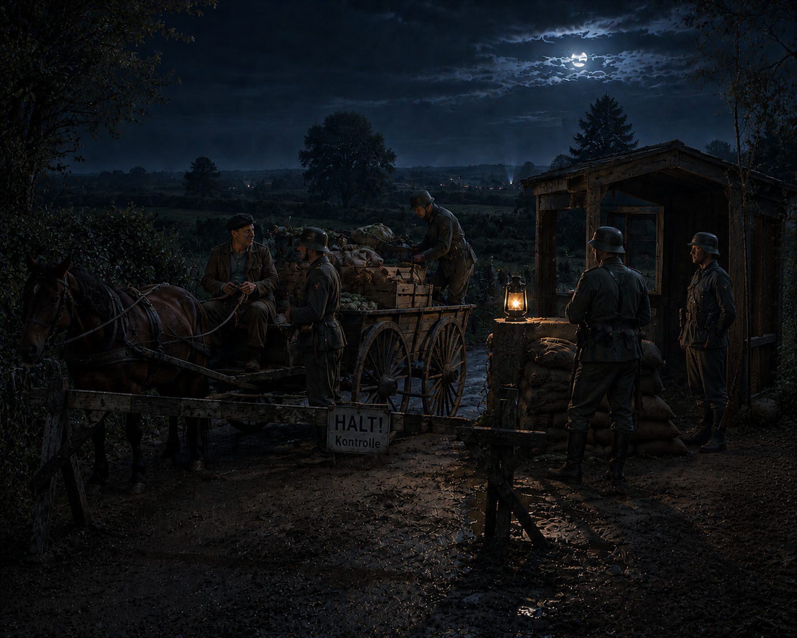

Ahead, a narrow country road is blocked by a German checkpoint, where several soldiers have stopped a horse-drawn cart belonging to a French farming family. Crates, sacks of vegetables, and household goods are piled high in the wagon while a German soldier questions the nervous driver and another searches through the cargo. 

There are 3 other German soldiers nearby.

The confrontation provides the characters with an opportunity to use the distraction to slip past through the adjoining fields, remain concealed and observe the checkpoint, or intervene if the civilians appear to be in immediate danger. Only a handful of Germans are visible, but additional soldiers may be concealed behind a wall, inside a nearby building, or positioned farther along the road. 

The civilians add another uncertainty: if fighting suddenly begins, they may panic, run into the line of fire, or inadvertently reveal the paratroopers' position. A quiet encounter could become a firefight in seconds, potentially bringing German reinforcements from nearby patrols or positions and leaving the characters responsible for civilians caught in the middle.

Options:
- Use distraction to slip by
- Intervene or assist civilians
- Observe and bypass

Complications:
- Hidden troops nearby
- Civilians may panic or betray presence
- Sudden escalation if shots fired

Checks:
- PRS + Influence deception to create distraction
- DEX + Stealth to bypass
- INT + Survival to coordinate timing

Outcomes:
- Success: Clean bypass or intel gain
- Failure: Engagement with alerted enemies

#### **Phase 3: The Causeway**

The causeway rises above a broad expanse of flooded fields, carrying a narrow road toward a stone-and-concrete bridge spanning a deep canal or branch of the river. With water and marshland stretching away on both sides, the roadway provides one of the few practical routes across the area—and leaves anyone approaching it dangerously exposed. 

At Night:

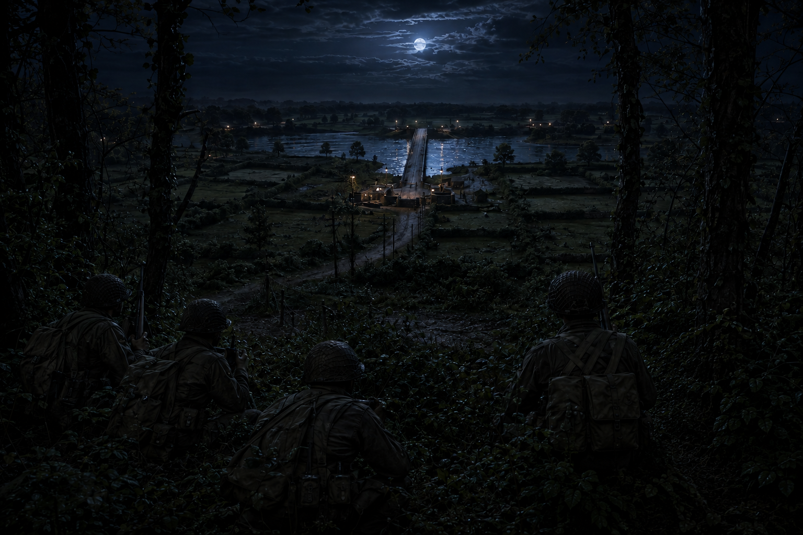

At Dawn:

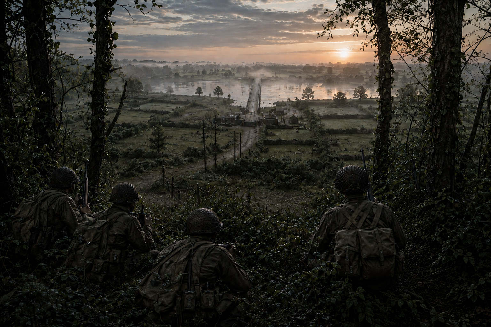

At the bridge, the Germans have established a sandbagged guard post occupied by six to ten soldiers under an NCO, with an MG 42 positioned to fire directly along the causeway. 

Depending on the strength of the position, the machine-gun team may instead be supported or replaced by an Sd.Kfz. 251 half-track armed with forward- and rear-facing MG 42s. 

The flooded fields make a rapid flanking attack nearly impossible, forcing the paratroopers to rely on darkness, concealment, diversion, or a direct assault to reach the bridge. If the defenders raise the alarm, a truck-borne patrol may arrive as reinforcement, and given enough warning, a nearby mortar team can begin dropping rounds onto the exposed approaches. The characters have finally reached their objective after the long march from their scattered landing zone; now they must find a way to take the causeway before the Germans can organize a stronger defense.

##### American Troops

When the characters arrive at the Causeway, they are contacted by Captain Robert "Bob" Ellison. He has put together a rag-tag platoon from multiple paratrooper groups. He orders your team to place the explosives on the bridge while the rest of the platoon draws the German fire. 

##### **Layout**

- Narrow raised road over flooded fields
- Stone or concrete bridge crossing a canal/river branch
- Sandbagged German guard post at one end

##### **Enemy Forces (Typical)**

Guard Post:
- 1 Squad (6–10 soldiers)
- 1 MG team covering the road
-or
- Sd.Kfz. 251 with two MG 42 (font and back)
- 1 NCO in command

Optional Reinforcements:
- Truck patrol (arrives if alerted)
- Mortar team (if alarm raised early)

##### **Key Threats**

- Open ground = no cover
- MG fire dominates approach
- Flooded fields prevent flanking except via stealth

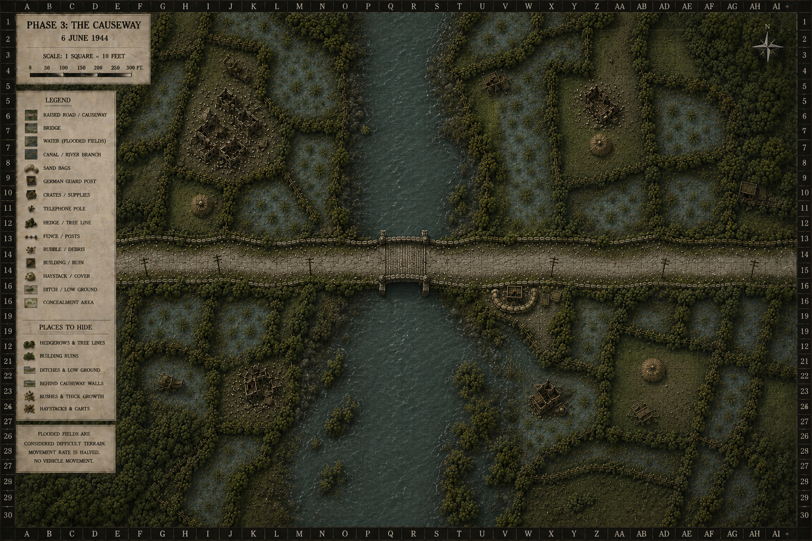

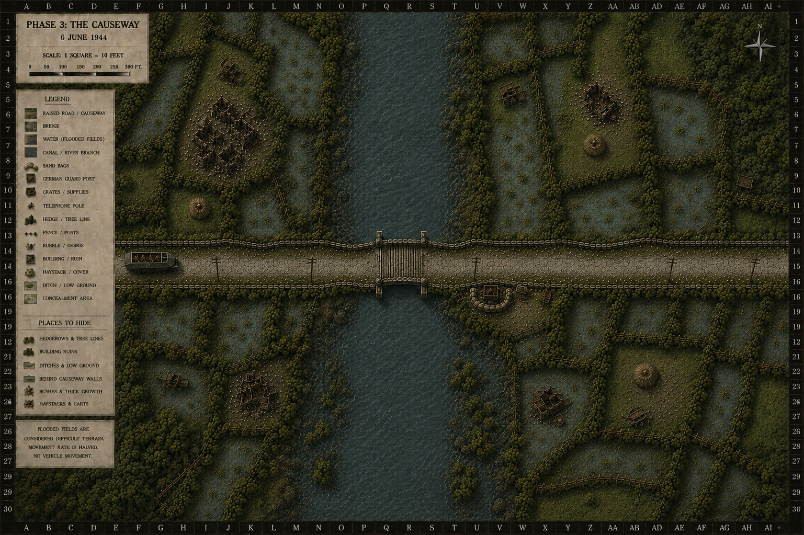

#### **Phase 4: Demolition**

##### **Options**

###### **1. Full Destruction**

- Place charges on bridge supports
- Requires time and exposure

###### **2. Partial Denial**

- Crater road surface
- Faster but less effective

###### **3. Ambush & Hold**

- Destroy vehicles instead of bridge

###### **Demolition Mechanics (Adapt to Your System)**

Steps:
1. Place charges (Demolitions check)
2. Set fuse or detonator
3. Withdraw to safe distance

Difficulty Factors:
- Under fire = higher difficulty
- Limited explosives = reduced effect
- Poor placement = partial damage

###### **Outcome Table**

| Result               | Effect                                            |
| -------------------- | ------------------------------------------------- |
| Critical Success | Bridge destroyed completely, no crossing possible |
| Success          | Bridge disabled, vehicles delayed significantly   |
| Partial          | Road damaged, infantry can still cross            |
| Failure          | Charges fail or incomplete detonation             |

#### **Phase 5: Extraction/Aftermath (Optional)**

##### **Options**

- Fall back into hedgerows
- Link up with larger airborne force
- Hold position against counterattack

##### **Complications**

- German reinforcements arrive
- Dawn breaks (visibility increases danger)
- Friendly forces approach unexpectedly

### **Rewards/Impact**

#### **If Successful**

- German counterattack delayed or prevented
- Easier beachhead consolidation

#### **If Failed**

- German armor reaches frontline sooner
- Future missions harder (higher Alert baseline)

### Special Rules

#### Stealth at Night
Any attempt at Stealth during the night are at +1 die.

#### Rest and Healing

Because this is a realistic adventure, there is little opportunity to recover from wounds during the night of the invasion.

- Minor Wound: Spending 30 minutes resting and receiving basic treatment removes one Minor Wound.
- Serious or Critical Wounds: Cannot be healed during the mission and must be endured.

If a character is incapacitated or unable to continue, the Game Master should introduce another soldier for the player to take over for the remainder of the mission.

#### Radio Silence

Before the beach landings begin, the paratroopers operate under strict radio silence. Their mission depends on the Germans remaining uncertain about the size, location, and objectives of the airborne forces scattered behind their lines. Radio transmissions could be intercepted by German signals units and potentially used to locate American positions or reveal that scattered airborne groups are beginning to organize around important roads, bridges, and defensive positions.

Until the assault troops begin landing on the beaches, the paratroopers must rely on prearranged plans, maps, recognition signals, runners, and contact with other scattered units.

#### **Dynamic Element: Alert Level**

The German Alert level starts at 0. 

Increase Alert Level when:
- Gunfire erupts
- Patrol escapes
- Parachutes or gliders found
- Explosions before main objective (x2)

Whenever there is a failure in an Event/Landmark that involves German troops, roll one d6 on the table below and add the current German Alert level to the number.

##### German Soldier Encounters (optional)

These encounters can be placed along roads, farm lanes, villages, hedgerows, or fields as the paratroopers make their way toward the causeway. Most German troops encountered during the night are uncertain about the scale of the airborne landings and may be investigating reports rather than actively hunting the characters.

| \#  | Encounter                  | Germans | Description                                                                                                                                                                                                                                                                    |
| --- | -------------------------- | ------- | ------------------------------------------------------------------------------------------------------------------------------------------------------------------------------------------------------------------------------------------------------------------------------ |
| 1   | Lost Sentry                | 1       | A lone German rifleman walks cautiously down a farm lane with his Kar98k ready. He has been separated from his post by the confusion of the airborne landings and is trying to find his way back. He may surrender if surprised and confronted by several Americans.           |
| 2   | Mounted Messenger          | 1       | A German soldier rides along a country road on horseback carrying a dispatch case. He is moving between isolated positions and knows the locations of several nearby checkpoints. Capturing his documents could provide useful intelligence.                                   |
| 3   | Searching Soldiers         | 2       | Two riflemen move slowly along opposite sides of a hedgerow, occasionally stopping to listen. They have found an abandoned American parachute and are searching for whoever landed nearby.                                                                                     |
| 4   | Motorcycle Dispatch Riders | 2       | Two Germans approach on a motorcycle, one driving and the other riding behind him. Their headlight may announce their arrival before they appear. They carry messages concerning reports of American parachutists and orders for nearby units.                                 |
| 5   | Motorcycle Patrol          | 4       | Two motorcycles travel together along a secondary road, each carrying a driver and passenger. The patrol moves quickly but periodically stops at intersections to investigate suspicious activity. One soldier carries a submachine gun while the others have rifles.          |
| 6   | Farm Search Party          | 4       | Four German soldiers move from farmhouse to farmhouse questioning civilians and searching barns, sheds, and haystacks for American paratroopers. They are spread out while searching, potentially allowing the characters to deal with them separately.                        |
| 7   | Mounted Patrol             | 4       | Four soldiers on horseback move slowly along a country lane. Their elevated position gives them a good view over fences and low vegetation, but the horses make considerable noise. Gunfire may cause the animals to panic.                                                    |
| 8   | Road Patrol                | 6       | Six infantrymen advance along a narrow road in two loose groups. One man walks well ahead as a scout while another trails behind the main body. The separation makes the patrol harder to ambush than it first appears.                                                        |
| 9   | Bicycle Patrol             | 6       | Six German soldiers travel on bicycles, rifles slung across their backs. They can cover considerable ground but are vulnerable while riding. If threatened, they abandon the bicycles and take cover in the nearest hedgerows.                                                 |
| 10  | Light Troop Carrier        | 6       | A small German troop carrier (Volkswagen Type 82 Kübelwagen) comes down the road carrying a driver and five soldiers. The vehicle periodically stops so troops can investigate crossroads and abandoned parachutes. The soldiers can dismount quickly if they suspect trouble. |
| 11  | Truck Patrol               | 8       | A German military truck carries a driver and seven infantrymen along the main road. The soldiers are being sent to investigate reports of parachutists. If attacked, the driver attempts to get the truck clear while the infantry dismount and seek cover.                    |
| 12  | Paratrooper Search Party   | 8       | Eight infantrymen systematically sweep the fields and hedgerows. They have already discovered American parachutes and equipment and know enemy airborne troops are nearby. Two men search ahead while the remainder follow as a supporting group.                              |

##### Using the Encounters

During the first hours after the airborne drop, the Germans should generally appear confused and reactive rather than perfectly coordinated. A lone messenger might ride straight past hidden characters, while a patrol could suddenly stop after finding a parachute hanging from a tree. Larger groups become more common as dawn approaches and German units begin receiving reports about the scale of the airborne landings.

#### **Terrain Effects**

##### **Flooded Fields**

- Movement slowed
- Risk of falling / noise
- No cover

##### **Hedgerows**

- Excellent cover
- Limited visibility
- Close-quarters combat

##### **Causeway**

- Fast movement
- Completely exposed

## **NPCs**

### **German Soldier** 

Defense (Physical): 3
Defense (Mental): 2
Defense (Social): 1
Attack (Close Combat): 3
Attack (Ranged Combat): 4

Weapons: Karabiner 98k Bolt Action, Bayonet.

or

Light Machine gun (MG42) (operator and assistant)  - Multiple Attack x2.

Wound Slots:

| Level    | Injury Description |
| -------- | ------------------ |
| Minor    |                    |
| Serious  |                    |
| Critical |                    |
| Lethal   |                    |

### German Soldier NCO (or Waffen-SS Soldier)

Defense (Physical): 3
Defense (Mental): 2
Defense (Social): 2
Attack (Close Combat): 4
Attack (Ranged Combat): 4

Weapons: MP40 submachine gun, Bayonet, 1 Stick Grenade (Stielhandgranate 24)

Special Attack: Grenade (Saving Throw Difficulty 3)

Multiple Attack: Submachine gun x2

Wound Slots:

| Level    | Injury Description |
| -------- | ------------------ |
| Minor    |                    |
| Minor    |                    |
| Serious  |                    |
| Critical |                    |
| Lethal   |                    |

### **German Officer**

Defense (Physical): 3
Defense (Mental): 4
Defense (Social): 4
Attack (Close Combat): 4
Attack (Ranged Combat): 4

Weapons: MP40 submachine gun, Bayonet, Lugar P08, 2 M39 egg grenades, 2 smoke grenades

Special Attack: Grenade (Saving Throw Difficulty 3)
Or smoke grenade (blinded condition)

Multiple Attack: Submachine gun x2

Wound Slots:

| Minor    | Injury Description |
| -------- | ------------------ |
| Minor    |                    |
| Minor    |                    |
| Serious  |                    |
| Serious  |                    |
| Critical |                    |
| Lethal   |                    |

### **WW2 German Soldier Loadout (Wehrmacht Infantry)**

#### **Standard Uniform & Gear**

- M40/M42 Feldbluse (Field Tunic) – Field-gray wool jacket
- Field Trousers (Feldhose) – Matching wool trousers
- Stahlhelm (M35/M40/M42 Helmet) – Often with camouflage cover or netting
- Jackboots (Marschstiefel) or Ankle Boots with Gaiters (later war)
- Y-Straps (Koppeltragegestell) – Load-bearing suspenders
- Leather Belt with Buckle – “Gott mit uns”

#### **Primary Weapon**

- Karabiner 98k Bolt-Action Rifle
    - 5-round internal magazine
    - Effective and highly accurate standard issue

#### **Ammunition & Weapon Gear**

- Ammo Pouches (Patronentaschen) – Usually 60 rounds total (two pouches)
- Stripper Clips for quick reload
- Bayonet (Seitengewehr 84/98)
- Rifle Sling

#### **Field Equipment (Web Gear)**

- Bread Bag (Brotbeutel) – Carries rations and small gear
- Canteen (Feldflasche) – Often with cup and felt cover
- Mess Kit (Kochgeschirr) – Cooking/eating tin
- Gas Mask Canister (Gasmaske Behälter) – Often used for storage by mid-war
- Entrenching Tool (Spaten) – Small shovel (can double as weapon)
- Zeltbahn (Shelter Quarter) – Poncho/tent half with camouflage pattern

#### **Combat & Utility Gear**

- Stick Grenades (Stielhandgranate 24)
- Helmet Cover / Camouflage (Splinter pattern, foliage, etc.)
- Bandolier (sometimes used for extra ammo)
- Bread Bag Strap Attachments (cup, utensils, cleaning kit)

#### **Personal Items**

- Soldbuch (paybook / ID)
- Letters, photos from home
- Cigarettes / matches
- Field dressing / basic medical kit
- Pocket knife

#### **Specialist Variations**

NCO (Squad Leader):
- MP40 Submachine Gun
- Map case, binoculars
- Whistle for command

Machine Gun Team (MG34/MG42):
- Ammo belts & drums
- Spare barrel case
- Tool kit

### List of German Names

Hans Becker
Otto Klein
Wilhelm Schäfer
Karl Neumann
Franz Bauer
Erich Hoffmann
Walter Krüger
Heinrich Vogel
Friedrich Hartmann
Josef Wagner
Ernst Müller
Kurt Weber
Dieter Brandt
Gerhard Richter
Hermann Keller
Klaus Schneider
Werner Koch
Rudolf Stein
Alfred Lehmann
Max Fischer
Wolfgang Adler
Günther Reinhardt
Friedrich Baumann
Konrad Jäger
Erwin Hoffmann

### German Phrases

Halt! - Stop!
Wer da? - Who goes there?
Achtung! - Watch out!
Amerikaner! - Americans!
Fallschirmjäger! - Paratroopers!
In Deckung! - Take cover!
Los! Los! - Move! Move!
Feuer! - Fire
Hände hoch! - Hands up!
Durchsucht das Gebiet! - Search the area!
Nicht schießen! - Don't shoot!
Alarm! - Alarm!

### Images

![[622359198_862438879966332_6950980302835044393_n.jpg]]

![[6-juin-paras-us.png]]

![[EdwardClarketoken.png]]

![[GeorgeRamireztoken.png]]

![[ThomasBakertoken.png]]

![[FrankDonnellytoken.png]]

![[RobertEllisontoken.png]]

![[JosephCarusotoken.png]]

![[LeonardKowalskitoken.png]]

![[DanielYazzietoken.png]]

![[WilliamHensleytoken.png]]

![[HaroldLevinetoken.png]]

![[JamesCaldwelltoken.png]]

