## **Dog Company – Special Mission Squad (Normandy, 1944)**

101st Airborne Division – 506th Parachute Infantry Regiment

---
### **Player Characters**

#### **Lieutenant (Platoon Leader)**

2nd Lt. James “Jimmy” Caldwell

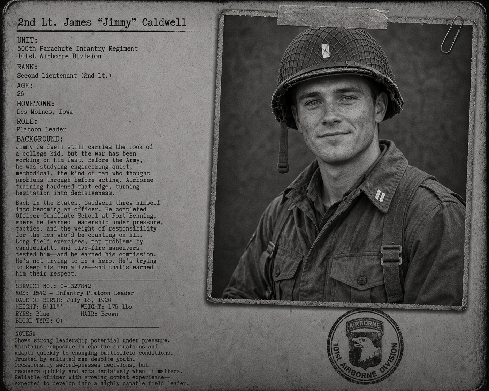

Attributes:
STR: 2
DEX: 2
RES: 2
INT: 3
ACT: 2
PRS: 3

Background: Scholar (Engineering)
Academics 1, Investigation 1, Technology 1

Background: Soldier 
Athletics 1, Ranged Combat 1, Survival 1 

Personal Skills: 7

Basic Skills:(13 points)
Academics (INT): 2
Athletics (STR): 2
Close Combat (STR): 1
Crafting (DEX or INT): 1
Finesse (DEX): 1
Influence (PRS): 3
Investigation (INT): 2
Ranged Combat (DEX): 3
Medicine (INT): 1
Perception (ACT): 2
Performance (PRS): 1
Stealth (DEX): 2
Survival (ACT or INT): 2
Technology (INT): 2 
Vehicle (DEX or INT): 1 

Wounds:

| Wound Level | Slots |
| ----------- | ----- |
| Minor       | 2     |
| Serious     | 2     |
| Critical    | 1     |
| Lethal      | 1     |
##### Edge
**Command (Level 1)**
Leading and directing others in combat, using orders, tactics, and presence to coordinate allies and disrupt enemies. Effect: One free combat Help reaction per turn.

##### **Weapons and Special Equipment** 
Thompson Submachine Gun +4
M1911 Pistol +3
2 Mk 2 Grenade (“pineapple”) +5
2 Smoke grenades for signaling
Knife +3

#### **Radio Operator (RTO)**

Pfc. Harold “Sparks” Levine

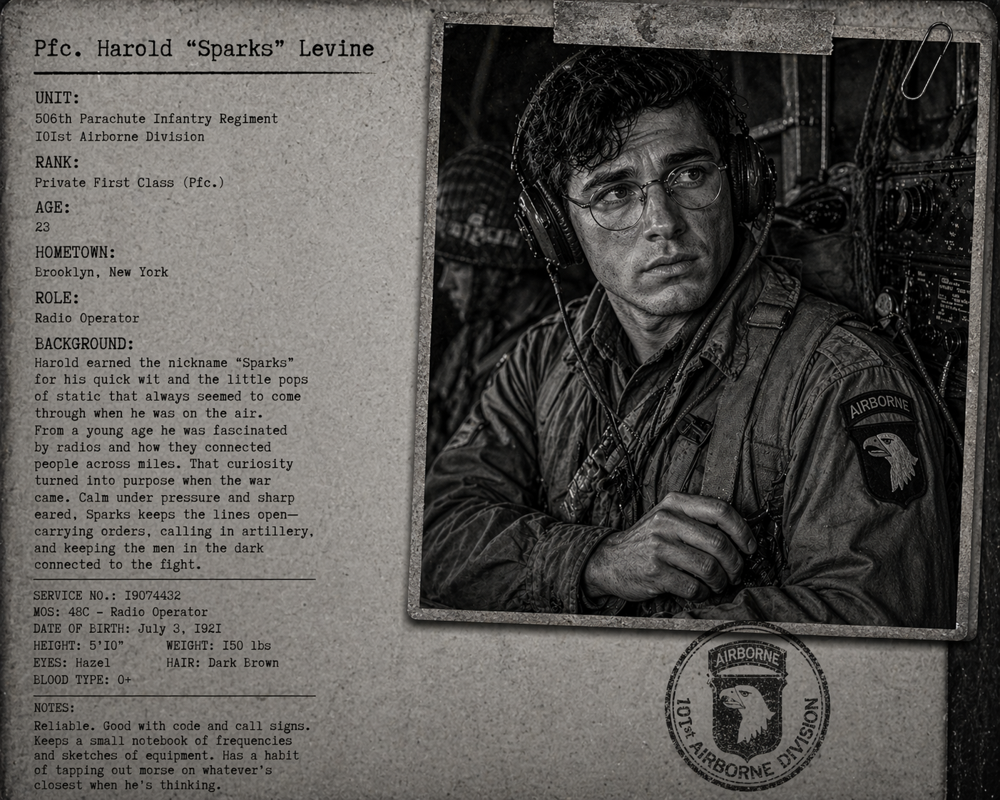

Attributes:
STR: 2
DEX: 2
RES: 2
INT: 3
ACT: 2
PRS: 3

Background: Technician (Electrician)
Investigation 1, Technology 2

Background: Soldier 
Athletics 1, Ranged Combat 1, Survival 1 

Personal Skills: 7

Basic Skills: (13 points)
Academics (INT): 2
Athletics (STR): 2
Close Combat (STR): 1
Crafting (DEX or INT): 2
Finesse (DEX): 2
Influence (PRS): 2
Investigation (INT): 2
Ranged Combat (DEX): 2
Medicine (INT): 1
Perception (ACT): 1
Performance (PRS): 2
Stealth (DEX): 2
Survival (ACT or INT): 2
Technology (INT): 3
Vehicle (DEX or INT): 1 

| Wound Level | Slots |
| ----------- | ----- |
| Minor       | 2     |
| Serious     | 2     |
| Critical    | 1     |
| Lethal      | 1     |
##### Edge 
**Linguistic Savant (Level 1)** 
Rapid comprehension of new languages. Effect: Learn new languages twice as fast and gain a +1 to Investigation checks for deciphering unknown dialects. Under these conditions, you may reroll 1 die as a free action once per scene.

Knows a little German and a bit of French.

##### **Weapons and Special Equipment**
M1A1 Carbine +3
Knife +3
Radio Set (lost in jump)
Small toolset

#### **Medic**

T/5 William “Doc” Hensley

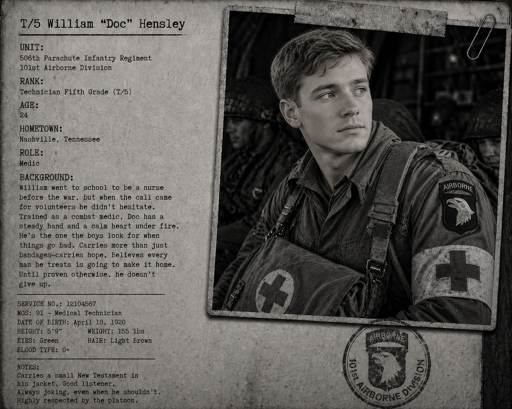

Attributes:
STR: 2
DEX: 2
RES: 2
INT: 3
ACT: 3
PRS: 2

Background: Physician (Emergency Medicine)
Academics 1, Medicine 1, Perception 1

Background: Soldier 
Athletics 1, Ranged Combat 1, Survival 1 

Personal Skills: 7

Basic Skills: (13 points)
Academics (INT): 2
Athletics (STR): 2
Close Combat (STR): 1
Crafting (DEX or INT): 1
Finesse (DEX): 3
Influence (PRS): 2
Investigation (INT): 2
Ranged Combat (DEX): 2
Medicine (INT): 3
Perception (ACT): 2
Performance (PRS): 1
Stealth (DEX): 1
Survival (ACT or INT): 2
Technology (INT): 1
Vehicle (DEX or INT): 1 

| Wound Level | Slots |
| ----------- | ----- |
| Minor       | 2     |
| Serious     | 2     |
| Critical    | 1     |
| Lethal      | 1     |
##### Edge 
**Focused Mind (Level 1)** 
Your mental resilience allows you to resist distractions and minor psychological manipulation. Effect: Gain a +1 saving throws for resisting conditions: Controlled, Dazed, or Distracted. Under these conditions, you may reroll 1 die as a free action once per scene.

##### **Weapons and Special Equipment**
M1A1 Carbine +3
Knife +3
MD 9712000 Medical Kit 
Extra Canteen

#### **Recon / Sniper**

Cpl. Daniel “Hawk” Yazzie

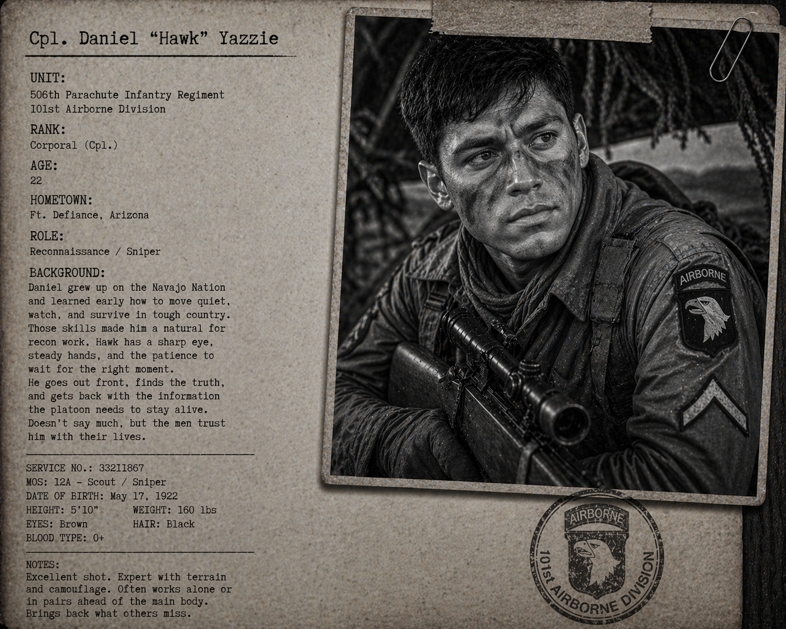

Attributes:
STR: 2
DEX: 4
RES: 2
INT: 2
ACT: 3
PRS: 1

Background: Explorer (Scout)
Athletics 1, Perception 1, Survival 1

Background: Soldier 
Close Combat 1, Ranged Combat 1, Survival 1 

Personal Skills: 7

Basic Skills: (13 points)
Academics (INT): 1
Athletics (STR): 2
Close Combat (STR): 2
Crafting (DEX or INT): 1
Finesse (DEX): 2
Influence (PRS): 1
Investigation (INT): 2
Ranged Combat (DEX): 3
Medicine (INT): 2
Perception (ACT): 2
Performance (PRS): 1
Stealth (DEX): 2
Survival (ACT or INT): 3
Technology (INT): 1
Vehicle (DEX or INT): 1 

| Wound Level | Slots |
| ----------- | ----- |
| Minor       | 2     |
| Serious     | 2     |
| Critical    | 1     |
| Lethal      | 1     |
##### Edge
**Deadeye Marksman (Level 1)**
Improved aim and precision with firearms. Effect: +1 to hit when using firearms. Under these conditions, you may reroll 1 die as a fee action once per scene. 

##### **Weapons and Special Equipment**
M1903A4 Springfield bolt-action rifle +4, equipped with a 2.5x Weaver 330C (M73B1) scope (decrease range tier by 1)
Knife +3

#### **Heavy Weapons (BAR Gunner / Anti-Armor)**

Pfc. Leonard “Big Lenny” Kowalski

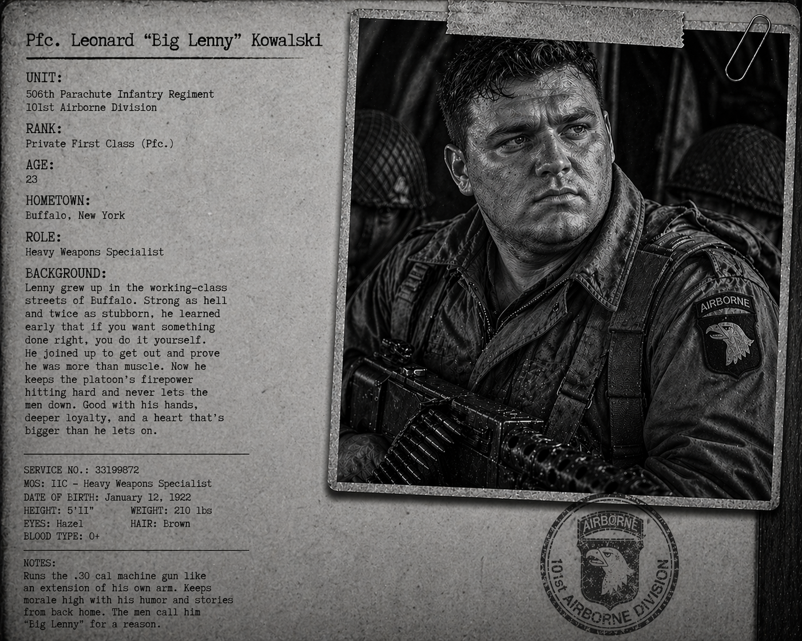

Attributes:
STR: 4
DEX: 2
RES: 4
INT: 1
ACT: 2
PRS: 1

Background: Criminal (Street Enforcer)
Close Combat 1, Influence 1, Ranged Combat 1

Background: Soldier 
Athletics 1, Ranged Combat 1, Survival 1 

Personal Skills: 7

Basic Skills: (13 points)
Academics (INT): 1
Athletics (STR): 3
Close Combat (STR): 3
Crafting (DEX or INT): 1
Finesse (DEX): 1
Influence (PRS): 2
Investigation (INT): 1
Ranged Combat (DEX): 3
Medicine (INT): 1
Perception (ACT): 2
Performance (PRS): 1
Stealth (DEX): 1
Survival (ACT or INT): 2
Technology (INT): 1
Vehicle (DEX or INT): 2

| Wound Level | Slots |
| ----------- | ----- |
| Minor       | 4     |
| Serious     | 2     |
| Critical    | 1     |
| Lethal      | 1     |
##### Edges
**Athletic Build (Level 1)**
Your physique is strong and agile. Effect: +1 to checks for lifting, carrying, or pushing.

##### **Weapons and Special Equipment**
Browning Automatic Rifle (squad automatic weapon) +5
Knife +3
2 Mk 2 grenades +5

#### **Mechanic / Demolitions**

T/4 Joseph “Joe” Caruso

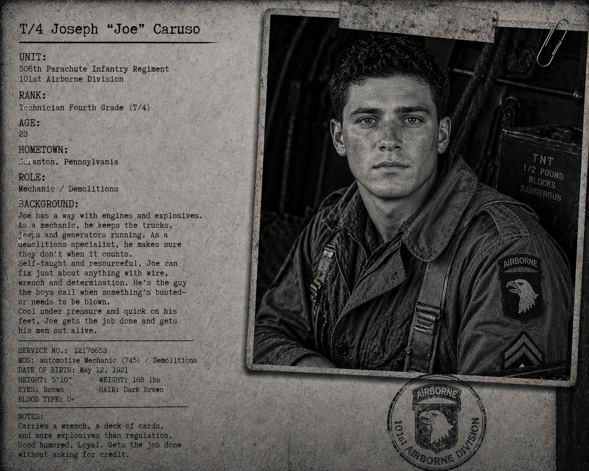

Attributes:
STR: 3
DEX: 3
RES: 3
INT: 2
ACT: 1
PRS: 2

Background: Technician (Mechanic)
Investigation 1, Technical 1, Vehicle 1

Background: Soldier 
Athletics 1, Ranged Combat 1, Survival 1 

Personal Skills: 7

Basic Skills: (13 points)
Academics (INT): 1
Athletics (STR): 2
Close Combat (STR): 2
Crafting (DEX or INT): 2
Finesse (DEX): 3
Influence (PRS): 1
Investigation (INT): 2
Ranged Combat (DEX): 2
Medicine (INT): 1
Perception (ACT): 1
Performance (PRS): 1
Stealth (DEX): 2
Survival (ACT or INT): 2
Technology (INT): 3
Vehicle (DEX or INT): 1

| Wound Level | Slots |
| ----------- | ----- |
| Minor       | 3     |
| Serious     | 2     |
| Critical    | 1     |
| Lethal      | 1     |
##### Edge
**Resourceful Scavenger (Level 1)**
Quick thinking helps identify and repurpose useful scraps. Effect: Gain a +1 to Investigation or Survival checks when searching for needed items. Under these conditions, you may reroll 1 die as a free action once per scene.

##### **Weapons and Special Equipment**
M1A1 Carbine +3
Knife +3
2 TNT satchel charges +6
Tool repair kit

### **NPCs**

#### **Captain (Company Commander)**

Captain Robert “Bob” Ellison

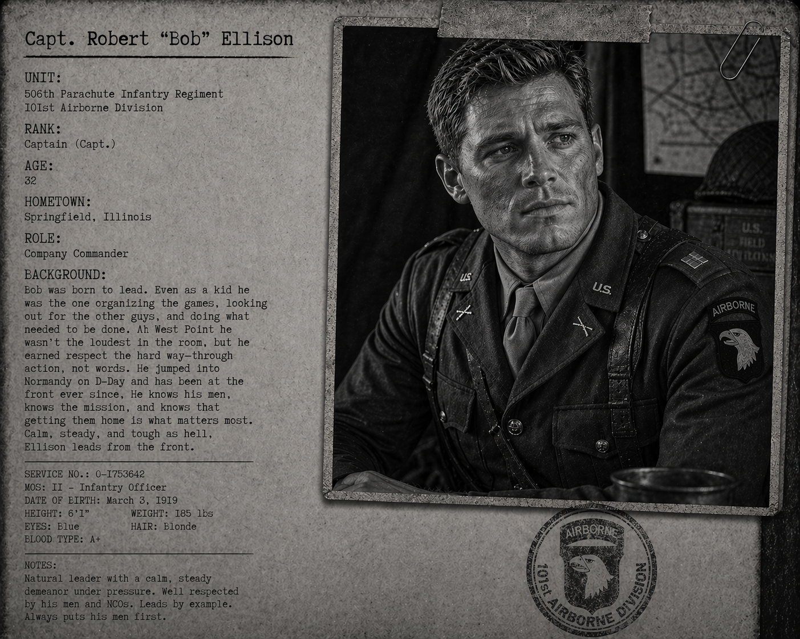

Attributes:
STR: 2
DEX: 2
RES: 2
INT: 3
ACT: 2
PRS: 3

Background: Official (Officer)
Academics 1, Influence 1, Investigation 1

Background: Soldier 
Athletics 1, Ranged Combat 1, Survival 1 

Personal Skills: 7

Basic Skills: (13 points)
Academics (INT): 2
Athletics (STR): 2
Close Combat (STR): 2
Crafting (DEX or INT): 1
Finesse (DEX): 1
Influence (PRS): 3
Investigation (INT): 2
Ranged Combat (DEX): 2
Medicine (INT): 1
Perception (ACT): 2
Performance (PRS): 2
Stealth (DEX): 2
Survival (ACT or INT): 2
Technology (INT): 2
Vehicle (DEX or INT): 1 

| Wound Level | Slots |
| ----------- | ----- |
| Minor       | 2     |
| Serious     | 2     |
| Critical    | 1     |
| Lethal      | 1     |
##### Edge 
**Command (Level 2)**
Leading and directing others in combat, using orders, tactics, and presence to coordinate allies and disrupt enemies. Effect: One free combat Help reaction at +2 per turn.

##### **Weapons and Special Equipment**
Thompson Submachine Gun +4
M1911 Pistol +3
2 Mk 2 Grenade (“pineapple”) +5
2 Smoke grenades for signaling
Knife +3

#### **Sergeant (Squad Leader / NCO)**

Sgt. Frank “Red” Donnelly

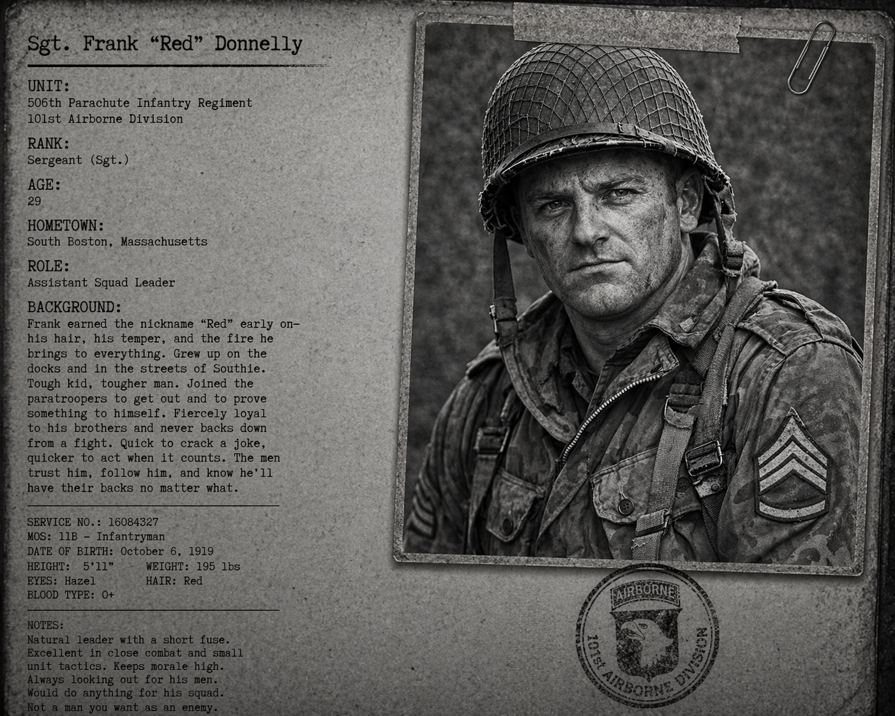

Attributes:
STR: 3
DEX: 2
RES: 3
INT: 2
ACT: 2
PRS: 2

Background: Laborer (Factory Worker)
Athletics 1, Crafting 1, Vehicle 1

Background: Soldier 
Athletics 1, Ranged Combat 1, Survival 1 

Personal Skills: 7

Basic Skills: (13 points)
Academics (INT): 1
Athletics (STR): 3
Close Combat (STR): 3
Crafting (DEX or INT): 2
Finesse (DEX): 1
Influence (PRS): 2
Investigation (INT): 1
Ranged Combat (DEX): 3
Medicine (INT): 1
Perception (ACT): 2
Performance (PRS): 1
Stealth (DEX): 1
Survival (ACT or INT): 2
Technology (INT): 1
Vehicle (DEX or INT): 1

| Wound Level | Slots |
| ----------- | ----- |
| Minor       | 3     |
| Serious     | 2     |
| Critical    | 1     |
| Lethal      | 1     |
##### Edge 
**Battlefield Awareness (Level 1)** 
A trained eye for danger reduces the risk of surprise attacks. Effect: +1 to Perception checks against ambushes and traps. Under these conditions, you may reroll 1 die as a free action once per scene.

##### **Weapons and Special Equipment**
Thompson Submachine Gun +4
M1911 Pistol +3
2 Mk 2 Grenade (“pineapple”) +5
2 Smoke grenades for signaling
Knife +3

#### **Rifleman #1**

Pfc. Thomas “Tommy” Baker

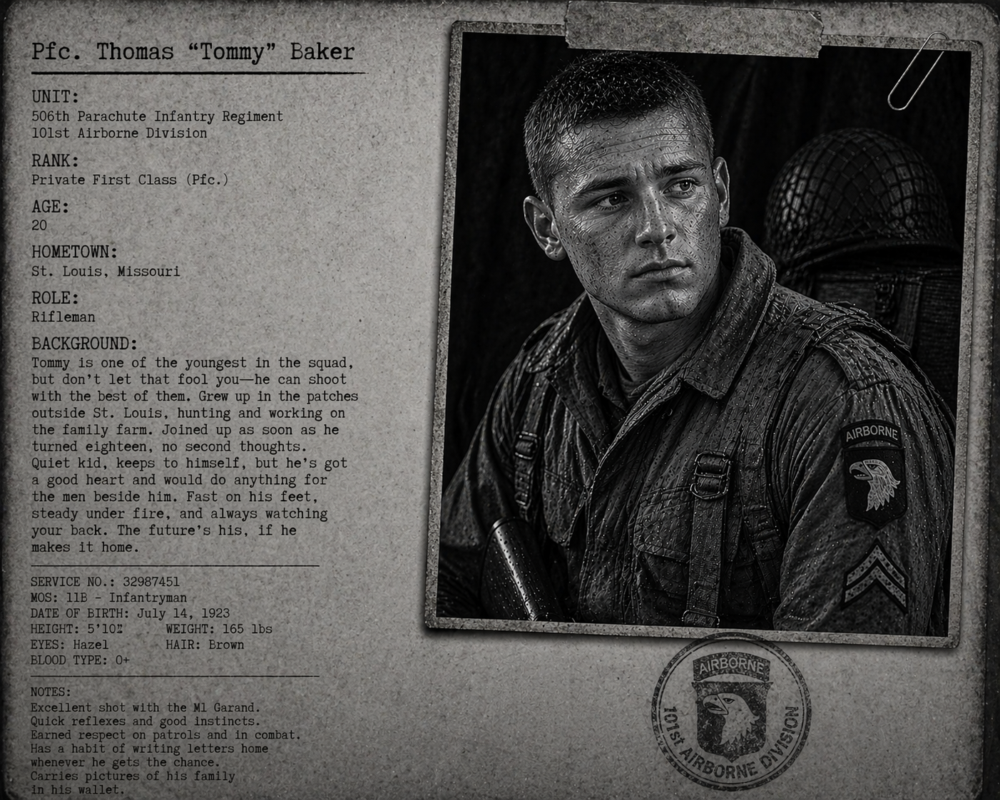

Attributes:
STR: 3
DEX: 2
RES: 3
INT: 2
ACT: 2
PRS: 2

Background: Athlete (Football Player)
Athletics 1, Close Combat 1, Finesse 1

Background: Soldier 
Athletics 1, Ranged Combat 1, Survival 1 

Personal Skills: 6

Basic Skills: (12 Points)
Academics (INT): 1
Athletics (STR): 3
Close Combat (STR): 2
Crafting (DEX or INT): 1
Finesse (DEX): 2
Influence (PRS): 1
Investigation (INT): 1
Ranged Combat (DEX): 3
Medicine (INT): 2
Perception (ACT): 2
Performance (PRS): 1
Stealth (DEX): 2
Survival (ACT or INT): 2
Technology (INT): 1
Vehicle (DEX or INT): 1 

| Wound Level | Slots |
| ----------- | ----- |
| Minor       | 2     |
| Serious     | 2     |
| Critical    | 1     |
| Lethal      | 1     |
##### Edge 
**Enhanced Reflex Training (Level 1)**
Quick reaction times improve combat readiness. Effect: Ability to act first in surprise rounds. At the beginning of combat the character may take a free attack at -2 before taking their normal action.

##### **Weapons and Special Equipment**
M1 Garand +4
Bayonet +3
2 Mk 2 grenades +5

#### **Rifleman #2**

Pfc. George Ramirez

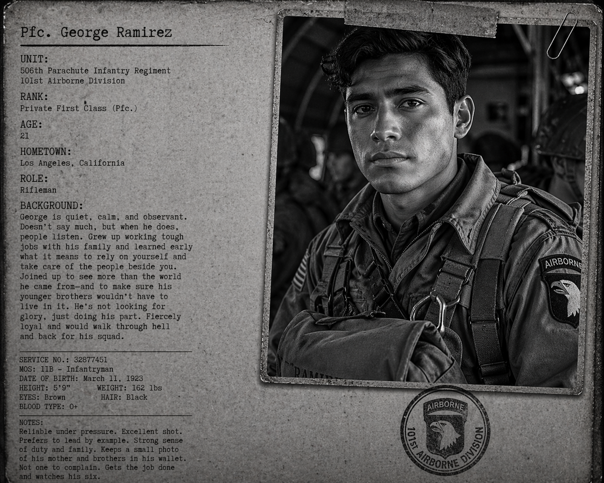

Attributes:
STR: 2
DEX: 2
RES: 3
INT: 2
ACT: 2
PRS: 2

Background: Laborer (Farm Laborer)
Athletics 1, Crafting 1, Vehicle 1

Background: Soldier 
Athletics 1, Ranged Combat 1, Survival 1 

Personal Skills: 6

Basic Skills: (12 Points)
Academics (INT): 1
Athletics (STR): 3
Close Combat (STR): 2
Crafting (DEX or INT): 2
Finesse (DEX): 1
Influence (PRS): 1
Investigation (INT): 1
Ranged Combat (DEX): 3
Medicine (INT): 1
Perception (ACT): 2
Performance (PRS): 1
Stealth (DEX): 2
Survival (ACT or INT): 2
Technology (INT): 1
Vehicle (DEX or INT): 2 

| Wound Level | Slots |
| ----------- | ----- |
| Minor       | 3     |
| Serious     | 2     |
| Critical    | 1     |
| Lethal      | 1     |
##### Edge 
**Explorer’s Instinct (Level 1)** 
You notice hidden paths and subtle environmental clues. Effect: +1 to Perception in outdoor or ruinous areas. Under these conditions, you may reroll 1 die as a free action once per scene.

##### **Weapons and Special Equipment**
M1 Garand  +4
Bayonet +3
2 Mk 2 grenades +5

#### **Rifleman #3**

Pfc. Edward “Eddie” Clarke

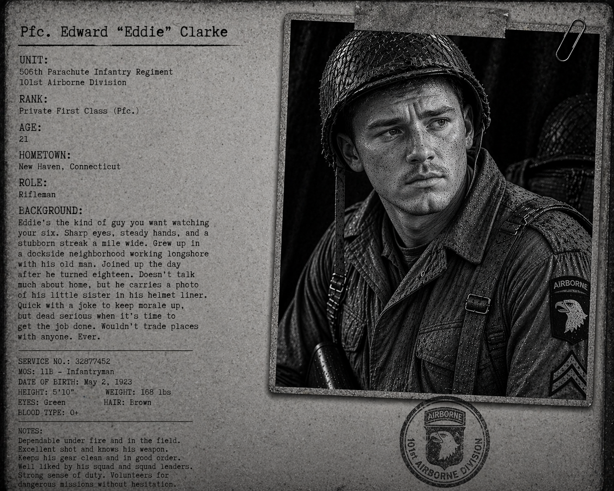

Attributes:
STR: 2
DEX: 3
RES: 2
INT: 2
ACT: 2
PRS: 2

Background: Laborer (Dock Worker)
Athletics 1, Crafting 1, Vehicle 1

Background: Soldier 
Athletics 1, Ranged Combat 1, Survival 1 

Personal Skills: 6

Basic Skills: (12 Points)
Academics (INT): 1
Athletics (STR): 3
Close Combat (STR): 2
Crafting (DEX or INT): 2
Finesse (DEX): 2
Influence (PRS): 1
Investigation (INT): 1
Ranged Combat (DEX): 3
Medicine (INT): 1
Perception (ACT): 1
Performance (PRS): 1
Stealth (DEX): 2
Survival (ACT or INT): 2
Technology (INT): 1
Vehicle (DEX or INT): 2

| Wound Level | Slots |
| ----------- | ----- |
| Minor       | 2     |
| Serious     | 2     |
| Critical    | 1     |
| Lethal      | 1     |
##### Edge 
**Tireless (Level 1)**
You recover quickly from physical exertion. Effect: Gain +1 die on Saving Throws made to resist fatigue, forced marches, sleep deprivation, or prolonged physical activity. Under these conditions, you may reroll 1 die as a free action once per scene.

##### **Weapons and Special Equipment**
M1 Garand +4
Bayonet +3
2 Mk 2 grenades +5

### **Company (Your Focus)**

- Dog Company (D Company)
- Part of 2nd Battalion, 506th PIR (Parachute Infantry Regiment)
- Roughly 120–150 men 

### What Dog Company Did on D-Day
- Dropped by parachute in the early hours of June 6, 1944
- Like most airborne units, widely scattered due to:
    - Heavy flak
    - Poor visibility
    - Pilot navigation issues
- Small groups of paratroopers regrouped ad hoc and:
    - Secured causeways from Utah Beach
    - Attacked German positions
    - Linked up with other elements of the 101st

Dog Company, like others, often fought as fragmented squads, making junior leadership (sergeants and lieutenants) critical.

### **Equipment**

Core Weapons & Ammunition
Primary Weapon

- M1A1 Carbine (most iconic airborne weapon)
- M1 Garand (more range/power)
- Thompson Submachine Gun (for NCOs, officers, assault troops)
- Ammo Load:
- Carbine: 6–10 magazines
- Garand: bandoliers of en-bloc clips (typically 80–120 rounds)
- Thompson: 5–10 magazines (heavy)

Sidearm

- M1911 Pistol (Usually for officers, NCOs, or specialists)
- 4 magazines .45 ammo

Grenades & Explosives

- Mk 2 Grenade (“pineapple”)
- Smoke grenades for signaling
- Gammon grenades / TNT (especially for airborne missions)

Uniform & Load-Bearing Gear
- Paratrooper Uniform & Helmet
- M42 Jump Uniform (reinforced knees/elbows)
- M1 Helmet with chinstrap (to prevent loss in jump)
- Jump boots (Corcoran boots)
- Gloves (for rope handling and protection)
- Web Gear (Load Bearing Equipment)
- Cartridge belt or ammo pouches
- Suspenders (to distribute weight)
- Musette bag (instead of standard pack for mobility)

Field Equipment & Survival Gear
Essential Kit

- Canteen (1–2)
- K-rations or D-rations
- Mess kit
- Extra socks & basic personal items
- Rain poncho / shelter half

Navigation & Utility
- Compass & maps
- Flashlight (often red-lens)
- Knife or bayonet
- Cricket clicker (used during Normandy for identification)

Special Airborne Equipment
Parachute & Drop Gear

- T-5 parachute
- Reserve chute
- Leg bag (extra gear dropped with soldier)
- Static line (attached in aircraft)

Entrenchment & Camouflage

- Folding shovel (entrenching tool)
- Camouflage netting or helmet scrim
- Face darkening (mud, charcoal)

Heavy / Team Weapons (Optional Loadout)
Support Weapons

- Browning Automatic Rifle (squad automatic weapon)
- Bazooka (anti-armor)
- Light mortars (carried in parts by team)

Satchel Charges

- Canvas bags filled with TNT or Composition C
	- Typically 15–20 lbs of explosives
	- Quick to deploy under fire

Typical Combat Load (Realistic Summary)
A paratrooper jumping into combat might carry:
- Primary weapon + 80–150 rounds
- 2–4 grenades
- 1–2 days of rations
- Water (1–2 canteens)
- Full web gear + musette bag
- Entrenching tool
- Extra socks & personal kit
Total weight: often 60–100+ lbs, especially on D-Day.

First Aid kit
The U.S. Parachute First-Aid Packet (1942–1945) was a compact, waterproof, rubberized canvas kit (often khaki) issued to paratroopers and pilots for immediate care of traumatic injuries during combat jumps, typically attached to helmets, webbing, or legs.

M1942 Aid Bag (Medic)
World War II US Army medic packs (such as the M1942 Aid Bag) and pouches were filled with field dressings, sulfa drugs, morphine syrettes, and surgical tools to treat wounds under fire. Key contents included Carlisle bandages, tourniquets, triangular bandages, adhesive tape, Iodine swabs, and scissors. 

Common Medic Pack Contents (MD 9712000 Kit)

- Bandages: 16 compressed gauze bandages (3-inch), 3 triangular bandages.
- Dressings: 8 small first aid dressings.
- Medical Tools: Bandage scissors, forceps, pencil, and emergency medical tags.
- Additions (Later War): Burn injury sets (boric acid ointment), eye dressing sets, and field tourniquets. 

Field Medic Essentials 

- Morphine Syrettes: Used for severe pain, often pinned to the patient's collar after use to indicate dosage.
- Sulfa Powder/Tablets: Used to prevent infection, often sprinkled on wounds or swallowed.
- Personal Pouch: Individual soldiers carried an M1924/M1942 pouch containing a Carlisle tin (bandages) and sulfa. 

Other Items:

- Documentation: Emergency Medical Tags to record injuries.
- Litter Straps: For transporting wounded on stretchers.
- Instruments: Sometimes included scalpels, sutures, and hemastats. International Museum of Surgical Science

Medics often carried extra canteens and sometimes cigarettes to comfort wounded soldiers.

